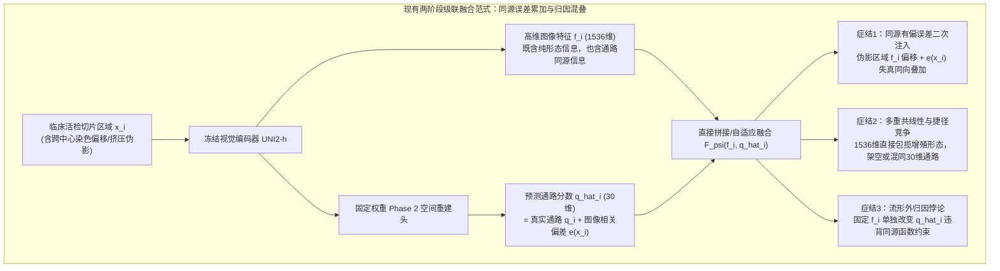
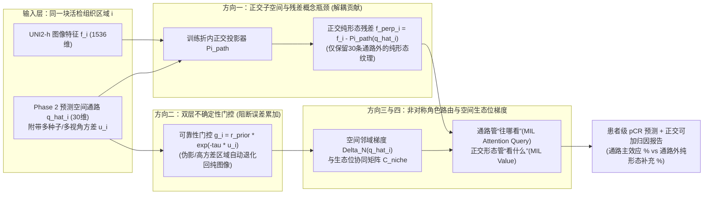

# 图像与空间通路多模态对齐及 Phase 3 去冗余辅助预测方案探索

- **文档定位**：研究方向探索与创新方案设计（属于**探索计划**，不改变现有已确认/已接纳实验结论）
- **生成日期**：2026-10-17
- **结合背景**：
  1. 李博士飞书最新论文初稿《基于 HE 图像的空间通路活性重建用于增强食管鳞癌新辅助免疫治疗疗效预测（HistoSPAR）》（[飞书知识库链接](https://wcnuw50cb7nc.feishu.cn/wiki/EAtUwvpOJieU0tkayMKcCjIYnCY)，底层文档 `Nq40dQvXSoHSb7xyB6bcGkU3nWZ`，最新修订版本 `revision_id: 557`，已成功完整读取）。
  2. Phase 2 最新冻结读出调优进展（[UNI2h冻结读出改版实验分析报告_20261016.md](file:///D:/AI空间转录病理研究/PFMval_new/03分析报告/UNI2h冻结读出改版实验分析报告_20261016.md)，`d4/c24m24` 方案在独立参考患者 XZY 上逐通路平均 PCC 达 `0.59242 ± 0.00304`，内部验证集达 `0.68260`）。
  3. 项目历史关于 Phase 3 伪多模态冗余与去相关融合的理论探讨（[Phase3_0803特征融合创新方案_讨论归档_20260808.md](file:///D:/AI空间转录病理研究/PFMval_new/project_state/plans/Phase3_0803特征融合创新方案_讨论归档_20260808.md)、[AI空转项目下一步研究计划探索_20261013.md](file:///D:/AI空间转录病理研究/PFMval_new/01_指南与解读/分析报告/AI空转项目下一步研究计划探索_20261013.md)）。

---

## 一、 飞书最新论文初稿（HistoSPAR, Rev 557）核心脉络与关键发现

在最新更新的飞书论文初稿中，整体工作被系统命名为 **HistoSPAR**，串联起“高分辨率空间转录组监督的形态—通路映射（Phase 2）”与“治疗前活检切片的新辅助免疫化疗病理完全缓解（pCR, ypT0N0）预测（Phase 3）”两个阶段：

### 1.1 初稿已确立的实验主线与核心结果

| 模块阶段 | 队列与样本规模 | 核心方法设计 | 最新初稿关键结果（Rev 557） |
| :--- | :--- | :--- | :--- |
| **Phase 2：空间通路活性重建** | 7 例未治疗 ESCC Visium HD 切片（约 $58\text{–}61\,\mu\text{m}$ 区域；6 例开发集：9,472 训练 + 1,078 内部验证区域；1 例独立外部患者 XZY：1,039 区域） | 冻结 **UNI2-h** 提取第 24 层 CLS（1,536 维）+ 256 个 patch token 均值（1,536 维）拼接为 **3,072 维**并做 D4 八视角平均；经局部有向 $k$-NN 图（距离核 $\times$ 余弦相似度核，$W_B$ 零初始化）输出 30 条癌症相关通路 z-score | 独立患者 XZY 上 30 条通路逐通路平均 PCC 从单点基线 `0.537`、旧读出空间残差 `0.571` 提升至 **`0.592 ± 0.003`**（内部验证集 `0.683`）；保留高密度空间网格显著优于 $2\times 2$ 稀疏采样（`0.555`）与随机等量采样（`0.541`） |
| **Phase 3：治疗前活检 pCR 预测** | 内部开发队列：**307 例**（中山医院本院，5 个预设划分共覆盖 111 例内部测试患者）；外部独立队列：**153 例**（厦门分院） | 固定预训练 Phase 2 模型，对每个活检区域 $i$ 生成 30 维预测通路 $q_i$，与 1,536 维图像特征 $f_i$ 输入自适应融合模块 $v_i = F_\psi(f_i, q_i) \in \mathbb{R}^{512}$，再经门控注意力多示例学习（Gated Attention MIL）预测 pCR | **内部测试（5 划分均值）**：融合模型 AUROC **`0.831`** vs 纯图像 **`0.779`**（准确率 `0.844` vs `0.793`）； **外部独立队列（153 例）**：融合模型 AUROC **`0.851`** vs 纯图像 **`0.820`**（准确率 `0.797` vs `0.784`） |
| **临床可解释性归因** | 111 例内部测试患者（5 个划分汇总） | **条件积分梯度（Conditional Integrated Gradients）**：固定图像特征 $f_i$ 与其余通路不变，将目标通路 $q_{ik}$ 从基线 0 积分至观测值 | **Inflammatory Response（炎症反应）**平均绝对条件归因最高（`0.161`），其次为 MYC targets、E2F targets、Mitotic Spindle |

### 1.2 初稿中提前暴露“直接特征融合怪异感”的三个关键实验线索

您在提问中敏锐指出：**“Phase 3 直接把图像特征预测的通路分数和图像特征进行融合，始终觉得有点怪怪的：一是可能带来累积误差效应，二是不好区分通路特征和图像特征各自到底帮助了什么。”**

事实上，李博士最新论文初稿中的三组实验数据，恰好从实证角度印证了您的直觉：

1. **线索一：外部队列个案迁移中的“双向拉扯”（负迁移现象）**
   - 在初稿第 2.4 节与图 3E 中，对比外部队列 153 例患者在固定阈值 0.5 下的判别变化：融合模型虽然成功把 **8 例**原本被纯图像模型误判为 pCR 的非缓解患者纠正回来（False Positive $\to$ True Negative），但**同时也把 6 例原本纯图像模型判断正确的患者改判错了**！
   - 这直接证明：当预训练 Phase 2 模型跨中心迁移到活检切片时，部分样本上的通路预测误差不仅没有被图像分支抵消，反而污染了原本正确的视觉判别。
2. **线索二：切片内图像—通路配对打乱（Within-Slide Shuffle）的“高残留性能”**
   - 在初稿第 2.6 节与图 5C 中，为了验证区域级配对的必要性，作者在训练 Phase 3 时将同一张切片内区域 $i$ 的图像特征 $f_i$ 与随机另一个区域 $\pi(i)$ 的预测通路 $q_{\pi(i)}$ 错位拼接。
   - 结果显示：错位配对后的内部测试平均 AUROC 依然高达 **`0.822`**（相比正常配对的 `0.831` 仅下降 `0.009`，主要体现在固定阈值准确率从 `0.844` 降至 `0.793`）。
   - 这说明现有的直接融合模块 $v_i = F_\psi(f_i, q_i)$ 在很大程度上**没有严格依赖点位级的“形态—通路精确对齐”**，而是把 $q_i$ 当成了切片级的全局背景偏置，或者与 $f_i$ 发生了信息混叠。
3. **线索三：“形态可重建性”与“临床决策效用”的分离**
   - 初稿明确发现：在 Phase 2 中预测最准的通路（如 MYC targets，XZY 上 PCC 达 `0.832`）往往只是细胞核高密度、高核质比等直观形态的直接复写；而在 Phase 3 临床 pCR 预测中贡献最大的 **Inflammatory Response（归因第一，`0.161`）**，其 Phase 2 重建 PCC 只有 `0.560`。如果直接无差别拼接，高方差、低信噪比的通路误差极易与高共线性的增殖通路混杂在一起。

---

## 二、 理论诊断：为什么“图像特征 + 图像预测的通路特征”直接融合会产生结构性矛盾？

从人工智能对齐（AI Alignment）与信息论视角来看，Phase 3 的输入并不是两个独立测量的模态，而是**同源级联特征（Cascaded Single-Source Representations）**。直接融合 $f_i$ 与 $\hat{q}_i = g_{\text{Phase2}}(x_i, \mathcal{N}_i)$ 存在三大结构性症结：

### 2.1 症结一：数据加工不等式与“输入相关性误差累加”（Input-Correlated Error Compounding）

在经典的传感器融合（如“CT 影像 + 血液化验”）中，两个模态的测量误差 $\epsilon_1, \epsilon_2$ 统计独立，融合后方差按 $\frac{1}{\sigma_1^{-2} + \sigma_2^{-2}}$ 下降。
但在本项目的推理阶段，患者只有一张 H&E 染色切片 $X$。预测通路 $\hat{q}_i$ 完全由图像块 $x_i$ 及其局部邻域特征算出：
$$\hat{q}_i = q_i^{\text{true}} + \epsilon(x_i, \mathcal{N}_i)$$
请注意，这里的误差项 $\epsilon(x_i, \mathcal{N}_i)$ **不是独立同分布的高斯白噪声，而是输入图像 $x_i$ 的确定性函数**！
- 当活检切片的某个局部区域 $i$ 出现**跨医院染色差异、组织挤压变形、烧灼边缘或坏死碎屑**时，视觉特征 $f_i$ 本身就会偏离训练分布；
- 此时，在 6 例手术切除/空转标本上训练出来的固定权重 Phase 2 模型，面对这种异常视觉输入 $x_i$，会产生大幅度的**外推幻觉（Extrapolation Error）**；
- 融合模块 $F_\psi(f_i, \hat{q}_i)$ 同时接收了偏离的 $f_i$ 和失真的 $\hat{q}_i$，由于两者的误差源完全锁定在同一块异常图像上，**误差不仅不会互相抵消，反而会发生相长干涉（同向放大）**。这就是为什么外部队列中有 6 例患者“单看图像是对的，加上预测通路反而判错”。

### 2.2 症结二：高维共线性与“流形外归因失真”（Collinearity & Off-Manifold Attribution）

1. **容量不对称与共线性抢功**：
   - $f_i$ 有 1,536 个维度，而 $\hat{q}_i$ 只有 30 个维度，且 $\hat{q}_i$ 本身就是从 UNI2-h 特征经一层 256 维瓶颈与局部图聚合算出来的。
   - 这意味着 $\hat{q}_i$ 中几乎所有的单点形态信息（尤其是高 PCC 的 MYC、E2F、G2M 等增殖通路）都**完全落在 $f_i$ 的线性/浅层非线性张成空间（Span）内部**。
   - 在 307 例患者的小样本 MIL 训练中，神经网络面对高度共线的 $(f_i, \hat{q}_i)$，参数分配具有极大的任意性（Identifiability Issue）：同一个“高核分裂象”信号，模型既可以把权重放在 $f_i$ 上，也可以放在 $\hat{q}_i$ 上，或者一边给正权重一边给负权重做内部抵消。
2. **条件积分梯度（Conditional IG）的流形外困境**：
   - 初稿为了评估通路贡献，采用了非常规范的条件积分梯度：固定 $f_i$ 不变，把某条通路 $q_{ik}$ 从 0 渐变到观测值 $\hat{q}_{ik}$。
   - 但从流形几何（Manifold Geometry）角度看，因为 $\hat{q}_i = g(x_i, \mathcal{N}_i)$，在真实数据分布中，$f_i$ 和 $\hat{q}_i$ 绑定在同一条低维流形曲线上。**固定 $f_i$ 不变而单独把 $\hat{q}_{ik}$ 设为 0，相当于造出了一个“视觉上明明是密集分裂的癌巢（$f_i$），但增殖/炎症通路却被强行清零（$q_{ik}=0$）”的虚拟怪异样本**。分类器在这些从未见过的流形外（Off-Manifold）区域的梯度，往往混杂了网络对特征冲突的非线性伪响应，难以干净地回答“通路到底帮了什么，图像到底帮了什么”。

### 2.3 症结三：Phase 2“均方误差重建对齐”与 Phase 3“临床判别对齐”的目标错位

Phase 2 训练时对 30 条通路一视同仁地优化回归误差（MSE/PCC），梯度天然被容易从单细胞核形态看出来的“增殖类通路”主导；而真正决定免疫检查点抑制剂疗效的微环境空间交互信号（如炎症浸润与间质屏障的空间博弈），在单点回归数值上信噪比偏低，直接按原值拼入 Phase 3 容易被高方差噪声掩盖。

---

## 三、 病理 × 空间组学 × 多模态对齐前沿进展全景调研（2023–2026）

围绕“如何对齐图像与分子/通路信息，并用于单模态临床推理”，近三年计算病理与可信多模态学习领域演化出 **5 大主流范式**。我们将代表性工作及其对本项目的直接启示汇总如下：

### 3.1 五大对齐与融合范式对比表

| 范式分类 | 代表性工作与核验来源 | 核心对齐机制 | 优势 | 局限性及对本项目的启示 |
| :--- | :--- | :--- | :--- | :--- |
| **1. 跨模态对比检索对齐** (Contrastive & Retrieval) | • **BLEEP** ([NeurIPS 2023](https://arxiv.org/abs/2306.01859)) • **OmiCLIP / Loki** ([Nature Methods 2025](https://doi.org/10.1038/s41592-025-02707-1)) • **mclSTExp** ([Brief. Bioinform. 2024](https://arxiv.org/abs/2309.04145)) | 用 InfoNCE 对比损失将 H&E 图像块与基因表达投射到同一超球面；推理时通过最近邻检索或余弦相似度匹配分子特征 | 跨模态检索能力强，把绝对数值回归转化为相对方向对齐，抗尺度漂移 | 检索式推断无法超越训练集表达谱凸包；但**“用方向/相对次序代替绝对数值”**的思想极适合跨中心活检迁移 |
| **2. 特权知识蒸馏与内化对齐** (Privileged Distillation / LUPI) | • **SEAL** ([arXiv:2602.14293, 2026](https://arxiv.org/abs/2602.14293)) • **MoPE** ([arXiv:2603.18566, 2026](https://arxiv.org/abs/2603.18566)) • **STPath** ([bioRxiv 2025](https://doi.org/10.1101/2025.04.24.650375)) • **SpaMIL** ([bioRxiv 2025](https://doi.org/10.1101/2025.06.13.659493)) | 将空间转录组视为**训练期特权信息（Privileged Information）**，通过对比蒸馏或通路专家路由直接重塑视觉编码器表征；**下游推理无需先显式生成基因数值再二次拼接** | **从根源上消除两阶段预测误差累加**；推理期模型结构极简、稳健 | 纯隐式蒸馏会牺牲“30 条显式生物学通路”的临床直观可解释性；需结合显式通路瓶颈与隐式表征对齐 |
| **3. 多模态子空间解耦对齐** (Disentangled Subspaces) | • **TriDeNT** ([Med. Image Anal. 2025](https://doi.org/10.1016/j.media.2025.103627)) • **PIBD 信息瓶颈** ([MICCAI 2024](https://arxiv.org/abs/2407.01993)) • **cVAE 解耦** ([Patterns 2024](https://doi.org/10.1016/j.patter.2024.100946)) • **SurvPath** ([CVPR 2024](https://arxiv.org/abs/2311.08776)) | 利用正交投影、互信息最小化或变分信息瓶颈，将表征强制拆分为**“跨模态共享（形态—通路共变）”**与**“模态私有（纯形态专属）”**两个独立子空间 | 彻底消除特征冗余与多重共线性；防止高维视觉分支吞噬低维分子信号 | 在小样本队列上若用复杂生成网络（如大型 VAE）易过拟合；**改用无参数/少参数的线性正交投影（PLS / QR）最契合本项目** |
| **4. 概念瓶颈与正交残差模型** (CBM & Orthogonal Residual) | • **Post-hoc CBM** ([ICLR 2023](https://arxiv.org/abs/2205.15480)) • **Incremental / Orthogonal Res-CBM** ([arXiv 2024–2025](https://arxiv.org/abs/2205.15480)) | 将 30 条通路视为人类可理解的“生物学概念瓶颈（Concept Bottleneck）”；主分支仅用概念预测，残差分支仅在**与概念严格正交的补空间**中拟合剩余纯形态信号 | **完美回答“通路帮了什么、图像又补充了什么”**；两者贡献可严格正交分解，支持流形内干预归因 | 需要确保残差分支与概念分支满足数学正交约束（如 Gram-Schmidt 投影或协方差惩罚），否则残差分支会重新喧宾夺主 |
| **5. 不确定性门控与反事实偏好对齐** (Uncertainty & Preference Alignment) | • **SURE** ([CVPR 2025](https://arxiv.org/abs/2503.00429)) • **MMedPO** ([ACL 2025](https://arxiv.org/abs/2412.06141)) • **TUR-DPO** ([arXiv:2603.05988, 2026](https://arxiv.org/abs/2603.05988)) | 显式估计伪标签/跨模态预测的不确定性（方差/熵），对高噪声区域动态降权；或通过反事实负样本对比抑制跨模态幻觉 | 直接抑制跨队列迁移时的“错上加错（负迁移）”；无需额外标注数据 | 极适合利用本项目现有的 **Phase 2 多种子方差（Seed Variance）**与**切片内打乱负对照（Within-slide Shuffle）** |

---

## 四、 破局思路：面向 HistoSPAR 的五大创新对齐研究方向

紧扣您的两个核心诉求——**① 消除两阶段累积误差效应**、**② 清晰解耦通路特征与图像特征各自的贡献**，并严格遵守本项目的基本准则（严守患者级划分、不触碰外部测试集调参、小步快跑可证伪），我们设计了 **5 个可以独立验证、也可组合推进的创新研究方向**：

---

### 方向一：正交子空间分解与残差概念瓶颈对齐（Orthogonal Residual Concept Bottleneck）
> **直接解决痛点**：彻底厘清“通路特征到底帮了什么，图像特征又帮了什么”，消除 1,536 维图像特征对 30 维通路特征的共线性架空与流形外归因失真。

#### 1. 为什么这样做？（通俗原理解析）
既然 30 维预测通路 $\hat{q}_i$ 是从图像算出来的，那么 1,536 维图像特征 $f_i$ 里其实混杂了两类信息：
- **第一类（已被 30 条通路概括的微环境功能形态）**：比如细胞核密集度对应的增殖（MYC/E2F）、淋巴细胞聚集对应的炎症反应（Inflammatory Response）、纤维化基质对应的上皮间质转化（EMT）。
- **第二类（30 条通路覆盖不到的纯组织学残差形态）**：比如食管鳞癌特有的角化珠（Keratin pearls）、细胞间桥、奇异巨核、坏死碎屑或特定的脉管浸润几何纹理。

如果把整块 $f_i$ 直接和 $\hat{q}_i$ 拼在一起，第一类信息就被重复输入了两次，网络根本分不清是谁在起作用。**最干净的做法是“先做减法，再做加法”**：在把图像特征送入 Phase 3 之前，先用正交投影把 $f_i$ 里“凡是能被 $\hat{q}_i$ 解释掉的成分”全部剥离干净，只留下**与 $\hat{q}_i$ 严格正交（零相关）的纯形态残差 $f_i^\perp$**！

#### 2. 具体应该怎么做？（数学与工程实现）
在 Phase 3 的**每一个训练折内部**（严禁使用验证集或测试集患者拟合投影矩阵）：
1. **第一步：拟合训练折内的“通路 $\to$ 图像”线性重构基底**
   在当前训练折的所有活检区域上，用带岭正则的最小二乘（Ridge Projection）或偏最小二乘（PLS），求解从中心化后的 30 维预测通路 $\tilde{q}_i \in \mathbb{R}^{30}$ 预测 1,536 维图像特征 $\tilde{f}_i \in \mathbb{R}^{1536}$ 的投影矩阵 $W_{\text{proj}} \in \mathbb{R}^{30 \times 1536}$：
   $$W_{\text{proj}} = (\tilde{Q}_{\text{train}}^\top \tilde{Q}_{\text{train}} + \lambda I_{30})^{-1} \tilde{Q}_{\text{train}}^\top \tilde{F}_{\text{train}}$$
2. **第二步：提取正交纯形态残差 $f_i^\perp$**
   对任意区域（训练、内部测试或外部队列均使用该训练折锁定的 $W_{\text{proj}}$），计算剥离了通路共线成分后的正交图像残差：
   $$f_i^\perp = \tilde{f}_i - \tilde{q}_i W_{\text{proj}}$$
   此时在数学上，$f_i^\perp$ 与预测通路 $\tilde{q}_i$ 的线性协方差近似为零（$\text{Cov}(\tilde{q}, f^\perp) \approx 0$）。
3. **第三步：双流正交可加 MIL 预测（Residual CBM 架构）**
   在包级（Slide-level）分类器或区域级融合器中，不把它们混成一个黑盒 MLP，而是设计为**主效应（通路概念分支）+ 正交残差修正（纯形态分支）**：
   $$\text{Logit}(Y = \text{pCR}) = \underbrace{g_{\text{path}}(\{\hat{q}_i\}_{i=1}^N)}_{\text{30条生物学通路的可解释主贡献}} + \underbrace{g_{\text{orth}}(\{f_i^\perp\}_{i=1}^N)}_{\text{30条通路之外的纯形态残差贡献}}$$
   训练时可附加一项轻量级的包级表征正交约束（如余弦相似度平方惩罚 $\mathcal{L}_{\text{orth}} = \cos^2(z_{\text{path}}, z_{\text{orth}})$），确保非线性变换后两分支依然互不侵占。

#### 3. 这一方案带来的科研收益
- **贡献度一目了然**：对任意一位患者，我们可以直接画出一条清晰的堆叠柱状图——例如：“该患者预测为 pCR 的对数几率中，**68% 来自 30 条空间通路活性（其中炎症反应占 +42%，EMT 占 -15%），另外 32% 来自 30 条通路未能覆盖的纯形态残差特征**”。
- **归因完全在流形内（On-Manifold）**：因为 $\hat{q}_i$ 和 $f_i^\perp$ 已经正交解耦，固定 $f_i^\perp$ 去分析 $\hat{q}_i$ 的边际贡献不再违反同源线性约束，审稿人无法再质疑共线性干扰！

---

### 方向二：不确定性校准与零初始化残差门控对齐（Uncertainty-Calibrated Residual Gating）
> **直接解决痛点**：正面击破“Phase 2 预测误差在 Phase 3 中累积放大”，直接针对李博士初稿图 3E 中那 **6 例外部队列因融合而改判错误的负迁移患者**。

#### 1. 为什么这样做？
Phase 2 模型是在 6 例高分辨率 Visium HD 手术标本上训练的，而 Phase 3 面对的是 460 例（307 内部 + 153 外部）临床活检小标本。活检标本不可避免地存在挤压、电灼、坏死、跨中心染色差异或未见过的间质背景。
在现有方案中，哪怕某块区域 $i$ 的预测通路 $\hat{q}_i$ 已经因为域偏移而严重失真，融合器 $F_\psi(f_i, \hat{q}_i)$ 依然按固定权重把它加进去，导致“错上加错”。**真正对齐的多模态系统必须知道“什么时候该相信预测的通路，什么时候该闭嘴退回纯图像”**。

#### 2. 具体应该怎么做？（零额外训练成本，直接挖掘现有模型资产）
我们不需要重新训练复杂的贝叶斯神经网络，可以直接从现有 Phase 2 资产中提取**双层可靠性权重（Dual-Level Reliability Gate）**：

1. **第一层：通路级先验可迁移权重 $r_k \in [0, 1]$（区分哪些通路值得信）**
   - 仅利用 Phase 2 开发集内部的验证指标（6 例开发患者的内部验证 PCC 或留一患者验证稳定性，**严禁偷看 XZY 和 Phase 3 队列**），对每条通路 $k \in \{1,\dots,30\}$ 计算收缩权重：
     $$r_k = \text{clip}\left(\frac{\text{PCC}_{\text{val}, k} - \tau_{\min}}{\tau_{\max} - \tau_{\min}},\, 0,\, 1\right)^\alpha$$
   - 这样，在跨患者验证中本身就接近随机猜测的极低信噪比通路会被自动压低权重，防止它们在 Phase 3 小样本中被当成噪声捷径拟合。
2. **第二层：区域级认知不确定性 $u_{ik}$（识别哪些活检区域正在“胡猜”）**
   - 我们在 Phase 2 中已经规范训练了 **3 个随机种子（`seed 42 / 43 / 44`）**，并且每个点位有 **D4 八个旋转镜像视角**！
   - 当把 Phase 2 模型应用到 Phase 3 活检切片的区域 $i$ 时，同时用 3 个种子的权重（或 D4 不同视角）推理，计算预测方差：
     $$u_{ik} = \text{Var}_{s \in \{42,43,44\}}\left(\hat{q}_{ik}^{(s)}\right)$$
   - **直观物理意义**：如果某块活检组织形态典型、处于 Phase 2 熟悉的分布内，3 个种子预测出的通路分数高度一致（$u_{ik} \to 0$）；如果该区域是电灼伪影或罕见异型结构，3 个种子在流形外各自乱猜，方差 $u_{ik}$ 会瞬间飙升！
3. **第三层：零初始化可靠性门控残差融合（Zero-Initialized Reliability-Gated Fusion）**
   将区域表征写成以纯图像表征 $v_i^{\text{img}} = \phi_{\text{img}}(f_i)$ 为安全锚点的门控残差形式：
   $$v_i = v_i^{\text{img}} + \gamma \cdot \text{MLP}_{\text{path}}\Big(\underbrace{\exp(-\beta \cdot u_i) \odot r}_{\text{点位×通路双层可靠性门控}} \odot \hat{q}_i\Big)$$
   其中标量或通道门控参数 $\gamma$ **初始化为 0**。

#### 3. 这一方案带来的科研收益
- **下限有保底（杜绝负迁移）**：因为 $\gamma$ 从 0 起步，且高不确定性区域 $\exp(-\beta u_i) \to 0$ 自动关闭通路注入，模型在遇到陌生伪影时平滑退化为纯图像基线，有望直接挽回初稿图 3E 中那 **6 例被负迁移带偏的外部患者**，同时保住那 8 例正向纠偏患者！
- **无需重跑 Phase 2 骨干**：只需在提取 Phase 3 活检切片的通路特征时，把现有的 3 个 seed 预测结果同时导出，算出均值 $\hat{q}_i$ 和方差 $u_i$ 即可。

---

### 方向三：非对称角色分工对齐——通路管“往哪看”（Query/Gate），图像管“看什么”（Value）
> **直接解决痛点**：打破“把 30 个数字和 1,536 个数字硬拼成一个向量”的惯性思维，赋予通路与图像截然不同的结构角色，同时彻底解决初稿图 5C“切片内打乱配对后 AUROC 仅降 0.009”的审稿隐患。

#### 1. 为什么这样做？
在现有的自适应融合 $v_i = F_\psi(f_i, q_i)$ 中，通路和图像都在同一个特征池里充当“被聚合的内容（Value）”。这不仅导致角色重叠，而且当切片内做随机打乱 $(f_i, q_{\pi(i)})$ 时，只要整张切片的 $\sum_i q_{\pi(i)}$ 均值不变，池化后的包特征依然能保留大部分全局通路信息——这就是为什么打乱后 AUROC 还有 `0.822`。

从肿瘤免疫病理学角度看，**空间通路活性最大的价值是什么？是充当“生物学显微镜的导航仪（Biological Attention Compass）”！**
- 活检切片里有大片普通间质、坏死、正常鳞状上皮和肿瘤核心，真正决定新辅助免疫化疗能否达到 pCR 的，往往是**“高炎症浸润（Inflammatory Response）与肿瘤增殖前沿（MYC/E2F）或纤维化屏障（EMT）交汇的关键生态位区域”**。
- 如果我们让**空间通路专门负责决定 MIL 的注意力权重（即决定“重点看哪块组织区域”）**，而让**图像特征（或正交形态残差）专门负责提供被选中区域的视觉表征（即“看清这块区域的细胞形态细节”）**，两者的职责就彻底分开了！

#### 2. 具体应该怎么做？
在 Phase 3 的门控注意力多示例学习（Gated Attention MIL）中，改造注意力打分机制为**跨模态非对称交叉路由（Asymmetric Cross-Modal Routing）**：
1. **引入局部空间通路梯度 $\Delta_{\mathcal{N}} \hat{q}_i$**：
   不仅输入区域 $i$ 自身的预测通路 $\hat{q}_i$，还计算它与局部邻域 $\mathcal{N}(i)$ 的通路差值 $\Delta_{\mathcal{N}} \hat{q}_i = \hat{q}_i - \frac{1}{|\mathcal{N}(i)|}\sum_{j \in \mathcal{N}(i)} \hat{q}_j$（刻画肿瘤—免疫交界面的空间跃变锋面）。
2. **通路主导注意力路由（Pathway-Guided Gate）**：
   在 Gated Attention 的 $\tanh(\cdot) \odot \sigma(\cdot)$ 双分支门控中，用图像特征计算基础候选激活，而**强制用空间通路（及其空间梯度）计算 Sigmoid 生物门控系数**：
   $$a_i = \frac{\exp\Big(w^\top \big[\tanh(V f_i^\perp) \odot \sigma(U [\hat{q}_i \,\|\, \Delta_{\mathcal{N}} \hat{q}_i])\big]\Big)}{\sum_{m=1}^M \exp\Big(w^\top \big[\tanh(V f_m^\perp) \odot \sigma(U [\hat{q}_m \,\|\, \Delta_{\mathcal{N}} \hat{q}_m])\big]\Big)}$$
3. **患者内相对次序归一化（Within-Slide Rank / Quantile Normalization）**：
   在送入注意力门控 $U$ 之前，对每张活检切片内部的 $\hat{q}_i$ 做切片内鲁棒标准化（如减去切片内中位数除以四分位距 IQR，或软排序分位数）。

#### 3. 这一方案带来的科研收益
- **天然免疫跨中心绝对尺度漂移**：因为注意力权重只取决于**同一张切片内部哪个区域的炎症/通路活性相对更高**（项目前期实验已证实，Phase 2 在外部切片上的患者内点位相对排序显著比绝对数值更稳健），跨医院染色深浅带来的全局基线偏移被 Softmax 自动消去，不会把数值误差带入下游分类器！
- **完美验证点位级对齐的因果必要性**：在这种架构下，点位 $i$ 的通路权重 $\sigma(U \hat{q}_i)$ 必须精准乘在点位 $i$ 的形态特征 $\tanh(V f_i^\perp)$ 上。如果再做“切片内配对打乱 $(f_i^\perp, \hat{q}_{\pi(i)})$”，高炎症门控就会被错误地扣在无关间质或坏死区域上，模型性能会自然显著回落，从而为论文提供无懈可击的**“局部空间形态—通路对齐不可替代”**的因果证据！

---

### 方向四：空间生态位二阶关系对齐（Spatial Niche Co-Activation & Interface Alignment）
> **直接解决痛点**：从“对齐孤立点位的 30 个数值”跃升到“对齐肿瘤微环境的空间交互拓扑”，挖掘纯图像单点特征无法直接表达的高阶生物学机制。

#### 1. 为什么这样做？
李博士初稿敏锐地发现：**Inflammatory Response（炎症反应）**是 pCR 预测中最核心的通路（归因值 `0.161`），同时 **MYC/E2F（增殖）** 与 **EMT（间质转化）** 紧随其后。
在肿瘤免疫学中，同样是切片整体具有中等偏高的炎症反应，临床结局可能截然相反：
- **免疫炎症型（Immune-Inflamed / 热肿瘤，易 pCR）**：炎症通路（Inflammatory / IFN-$\gamma$）与肿瘤增殖核心（MYC / E2F）在空间上**紧密共定位（正相关交织）**，杀伤性 T 细胞直接渗入癌巢内部；
- **免疫排斥型（Immune-Excluded，难 pCR）**：炎症通路虽然在切片里也存在，但被高活性的 **EMT / TGF-$\beta$ 纤维化基质屏障**挡在癌巢外围，空间上呈现“外圈炎症 + 中间 EMT 墙 + 内圈 MYC 癌巢”的**空间互斥/隔离格局**。

如果只把每个点位的 $(\hat{q}_i, f_i)$ 塞进普通 MIL 池化，这种**“谁和谁在空间邻域里挨在一起”**的二阶空间拓扑关系很容易在全局池化中丢失！

#### 2. 具体应该怎么做？
无需增加任何外部数据，直接在每张活检切片的局部空间图 $G = (\mathcal{V}, \mathcal{E})$ 上提取**空间生态位共激活特征（Spatial Niche Co-Activation Features）**：
1. **局部跨区域通路互相关矩阵（Spatial Cross-Correlation Matrix）**：
   对每张切片内部所有相邻区域对 $(i, j) \in \mathcal{E}$，计算中心化预测通路向量的空间滞后互协方差矩阵：
   $$C_{\text{spatial}} = \frac{1}{|\mathcal{E}|} \sum_{(i,j) \in \mathcal{E}} (\hat{q}_i - \bar{q})(\hat{q}_j - \bar{q})^\top \in \mathbb{R}^{30 \times 30}$$
2. **聚焦核心生物学交互轴（低维防过拟合版）**：
   为了防止在 307 例患者上引入过多特征维度（$30\times 30=900$ 维易过拟合），我们可以根据先验肿瘤免疫学机制或仅在训练折内筛选 Top-$K$（如 $K=6\text{–}10$ 个）最具代表性的**空间共定位/交界面指标**：
   - **免疫渗入指数**：高增殖点位（$\text{MYC/E2F} > \text{中位数}$）邻域内的平均 `Inflammatory Response` / `IFN-γ` 活性；
   - **间质屏障阻隔指数**：癌巢边界处 `EMT` / `TGF-β` 与 `Inflammatory Response` 的空间梯度乘积；
   - **增殖—缺氧耦合度**：`MYC/G2M` 与 `Hypoxia/Glycolysis` 的局部空间共激活度。

#### 3. 这一方案带来的科研收益
- **回答“通路究竟提供了什么图像直接看不出来的东西”**：单块 H&E 图像特征 $f_i$ 只看到局部 $224\times 224$ 像素的细胞长相；而空间通路交互特征显式刻画了**整张活检切片上“肿瘤增殖—免疫浸润—基质屏障”的三方空间博弈格局**。这不仅能提升 pCR 预测的生物学深度，还能直接在论文中画出一张极具冲击力的**“pCR 组（免疫渗入癌巢）vs non-pCR 组（EMT 屏障排斥免疫）”空间微环境拓扑对比图**！

---

### 方向五：训练期特权几何蒸馏与反事实配对正则（Privileged Relational Alignment & Counterfactual Pairing Loss）
> **直接解决痛点**：借鉴 2026 年最新 SEAL / MoPE / TUR-DPO 思想，从训练目标层面惩罚“忽略局部通路对齐的捷径学习”，并探索不依赖显式数值拼接的表征内化对齐。

#### 1. 具体应该怎么做？（两条可插拔路径）
1. **路径 A（极轻量，直接改造现有 Phase 3 损失函数）：切片内反事实错位边际损失（Within-Slide Counterfactual Margin Loss）**
   - 针对李博士初稿图 5C 中“切片内打乱配对 $(f_i, \hat{q}_{\pi(i)})$ 仍能拿到接近分数”的现象，我们可以在训练期把这种打乱变成**显式的反事实负样本约束**！
   - 对每个训练切片包，同时前向传播真实配对包 $B^+ = \{(f_i, \hat{q}_i)\}$ 和切片内随机错位配对包 $B^- = \{(f_i, \hat{q}_{\pi(i)})\}$（其中 $\pi$ 优先选择图像特征距离较远或通路差异较大的点位互换）。
   - 加入温和的排序边际正则（Margin Ranking Loss）：要求真实配对包在真实标签 $y$ 上的对数似然（或正确类别概率）高于错位配对包至少一个边际 $m$（如 $m=0.05$）：
     $$\mathcal{L}_{\text{CF}} = \max\Big(0,\, m - \big[\ell_{\text{true}}(B^+, y) - \ell_{\text{true}}(B^-, y)\big]\Big)$$
   - **作用**：强迫融合网络不能只靠“整张切片的平均通路分数 + 图像特征”偷懒过关，必须学会利用**点位 $i$ 的视觉形态与点位 $i$ 的局部通路活性完全吻合时**所产生的协同微环境特征。
2. **路径 B（中长期探索，彻底取消推理期两阶段数值拼接）：空间通路关系矩阵特权蒸馏（Privileged Relational Distillation）**
   - 在训练 Phase 3 的图像特征投影层 $h_i = \phi(f_i) \in \mathbb{R}^{512}$ 时，不把 $\hat{q}_i$ 作为输入拼接进去，而是把 $\hat{q}_i$ 作为**训练期的关系几何老师（Relational Teacher）**：
   - 计算同一张切片内各区域在预测通路空间中的余弦相似度矩阵 $S_{ij}^{\text{path}} = \cos(\hat{q}_i, \hat{q}_j)$，要求图像投影后的表征相似度矩阵 $S_{ij}^{\text{img}} = \cos(h_i, h_j)$ 在一个专属子空间（如前 128 维）内逼近 $S_{ij}^{\text{path}}$，而后 384 维保持纯形态自由度。
   - **作用**：推理时完全不需要再走“先预测 30 个通路数值、再拼回图像”的级联链条，直接用内化了通路几何结构的视觉投影层做预测，同时依然可以通过投影到 30 个通路原型向量上进行概念归因。

---

## 五、 遵守本项目核心原则的“小步快跑”落地方案建议

为了避免盲目扩大工程范围，并严格遵守本项目的科研有效性边界（[AGENTS.md](file:///D:/AI空间转录病理研究/PFMval_new/AGENTS.md)），任何下一步探索均须满足以下**四条铁律**：

> [!IMPORTANT]
> **必须坚守的实验科学边界**：
> 1. **严守患者级划分与零泄漏**：正交投影矩阵 $W_{\text{proj}}$、通路先验权重 $r_k$、标准化均值/方差以及门控超参数，**100% 只能在各自训练折（Phase 2 的 6 例开发集内部，或 Phase 3 的各折训练集患者内部）拟合**；绝不使用 Phase 2 独立患者 XZY 或 Phase 3 厦门分院 153 例外部队列参与任何参数拟合、阈值搜寻或模型挑选。
> 2. **固定主干做最小变量对照**：当检验 Phase 3 对齐与融合机制时，锁定同一版预训练 Phase 2 模型（先在初稿当前基准或最新 `d4/c24m24` 冻结读出模型上固定），保证所有对照组的唯一差异来自对齐/解耦机制本身。
> 3. **双口径与正负对照齐备**：Phase 2 相关评估同时报告逐通路平均 PCC 与整体展平 pooled PCC；Phase 3 实验必须包含**纯图像基线（Image-only）**、**纯通路基线（Pathway-only）**、**现有直接融合基线（Naive Adaptive Fusion）**以及**同维度 PCA/随机投影对照（30-D Image PCA Control，排除单纯增加 30 个自由度的容量混杂）**。
> 4. **明确区分探索与已确认结论**：所有新方案在完成运行、回传核验并经您审阅同意前，统一标注为“探索方案 / 待验证假设”，不修改现有已接纳实验记录。

### 推荐优先尝试的 3 个轻量级实验步骤（按性价比从高到低排序）

| 优先级步骤 | 步骤中文名称 | 具体改动内容（均无需重新训练 Phase 2 骨干） | 核心检验假设与预期解决的审稿痛点 |
| :--- | :--- | :--- | :--- |
| **第一步（最推荐，极速验证）** | **训练折内正交残差分解与双流可加归因实验** | 在现有 Phase 3 代码包基础上，于每折训练集内计算 $f_i^\perp = f_i - \hat{q}_i W_{\text{proj}}$，将输入从 $(f_i, \hat{q}_i)$ 替换为**正交解耦对 $(f_i^\perp, \hat{q}_i)$**，并输出通路分支与正交形态残差分支各自的独立 Logit 贡献占比 | **检验假设**：剥离共线性后，AUROC 保持或优于现有融合（`0.831` / `0.851`），且能首次给出**完全流形内、零共线混叠的“通路主效应 vs 纯形态补充效应”定量拆解图** |
| **第二步（消除负迁移）** | **多种子不确定性校准与零初始化门控融合实验** | 导出 Phase 2 现有 3 个随机种子（`42/43/44`）在活检切片上的预测方差 $u_{ik}$，加入零初始化可靠性门控 $v_i = v_i^{\text{img}} + \gamma \exp(-\beta u_i) \odot r \odot \hat{q}_i$ | **检验假设**：在外部 153 例独立队列上，重点检查初稿图 3E 中那 **6 例被负迁移带偏的样本**是否因为高不确定性门控关闭而恢复正确判别，实现外部泛化稳健性净提升 |
| **第三步（强化局部对齐与生物机制）** | **通路引导注意力路由与空间交界面梯度实验** | 让预测通路 $\hat{q}_i$ 及局部空间梯度 $\Delta_{\mathcal{N}}\hat{q}_i$ 专门控制 MIL 注意力门控（往哪看），正交图像残差 $f_i^\perp$ 提供特征值（看什么）；重跑“切片内打乱对照（Within-slide shuffle）” | **检验假设**：证明通路作为“微环境空间导航仪”的机制合理性，并使切片内打乱对照产生清晰显著的性能落差，彻底封堵“融合只学到全局均值偏置”的潜在审稿质疑 |

---

## 六、 关键参考文献与核验来源链接汇总

1. **HistoSPAR 论文初稿（李博士最新更新版，Rev 557）**：[基于HE图像的空间通路活性重建用于增强食管鳞癌新辅助免疫治疗疗效预测](https://wcnuw50cb7nc.feishu.cn/wiki/EAtUwvpOJieU0tkayMKcCjIYnCY)
2. **BLEEP** (Xie et al., NeurIPS 2023): *Spatially Resolved Gene Expression Prediction from Histology Images via Bi-modal Contrastive Learning*. [arXiv:2306.01859](https://arxiv.org/abs/2306.01859)
3. **OmiCLIP / Loki** (Chen et al., *Nature Methods* 2025): *A visual–omics foundation model to bridge histopathology with spatial transcriptomics*. [DOI:10.1038/s41592-025-02707-1](https://doi.org/10.1038/s41592-025-02707-1)
4. **mclSTExp** (Min et al., *Briefings in Bioinformatics* 2024): *Multimodal contrastive learning for spatial gene expression prediction using histology images*. [arXiv:2309.04145](https://arxiv.org/abs/2309.04145)
5. **SEAL** (2026): *Spatial Expression-Aligned Learning for Pathology Vision Foundation Models*. [arXiv:2602.14293](https://arxiv.org/abs/2602.14293)
6. **MoPE** (2026): *Mixture of Pathway Experts for Privileged Multi-Omics Distillation in Computational Pathology*. [arXiv:2603.18566](https://arxiv.org/abs/2603.18566)
7. **STPath** (Huang et al., *bioRxiv* 2025): *A generative foundation model for integrating spatial transcriptomics and whole-slide images*. [DOI:10.1101/2025.04.24.650375](https://doi.org/10.1101/2025.04.24.650375)
8. **SpaMIL** (Owkin / MOSAIC, *bioRxiv* 2025): *Multiple instance learning and spatial transcriptomics distillation for H&E survival prediction*. [DOI:10.1101/2025.06.13.659493](https://doi.org/10.1101/2025.06.13.659493)
9. **TriDeNT** (*Medical Image Analysis* 2025): *Tri-modal disentangled representation learning for histopathology and genomics integration*. [DOI:10.1016/j.media.2025.103627](https://doi.org/10.1016/j.media.2025.103627)
10. **SurvPath** (Jaume et al., CVPR 2024): *Modeling Dense Multimodal Interactions Between Biological Pathways and Histology for Survival Prediction*. [arXiv:2311.08776](https://arxiv.org/abs/2311.08776)
11. **PIBD** (MICCAI 2024): *Prototypical Information Bottlenecking and Disentangling for Multimodal Cancer Survival Prediction*. [arXiv:2407.01993](https://arxiv.org/abs/2407.01993)
12. **cVAE 形态—基因解耦** (Märtens & Yau, *Patterns* 2024): *Decomposing shared and modality-specific variation in spatial transcriptomics and histopathology*. [DOI:10.1016/j.patter.2024.100946](https://doi.org/10.1016/j.patter.2024.100946)
13. **Post-hoc & Residual Concept Bottleneck Models (PCBM / PCBM-h)** (Yuksekgonul et al., ICLR 2023): *Post-hoc Concept Bottleneck Models*. [arXiv:2205.15480](https://arxiv.org/abs/2205.15480)
14. **SURE** (CVPR 2025): *Uncertainty-Aware Multimodal Alignment with Calibrated Reliability*. [arXiv:2503.00429](https://arxiv.org/abs/2503.00429)
15. **MMedPO** (ACL Findings 2025): *Multimodal Medical Preference Optimization for Suppressing Hallucinations*. [arXiv:2412.06141](https://arxiv.org/abs/2412.06141)
16. **TUR-DPO** (2026): *Task-Utility Reinforced Direct Preference Optimization*. [arXiv:2603.05988](https://arxiv.org/abs/2603.05988)
