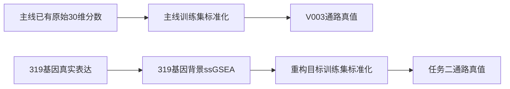

# 先预测基因再聚合通路：队友做了什么，比较争议在哪里

核对日期：2026年10月10日。本文区分最新版设计、最新接纳的单臂结果，以及更早的两臂更正结果，供你裁决比较范围。

**队友确实做出了基因预测后聚合通路的结果。此前“不匹配”的说法需要缩小范围：与V003主线评价目标不同，仍是直接判断路线优劣的限制；旧包两臂真值漂移，则已有可以复现的更正打分，不能继续据此否定更正表。**另外，“必须重现V003才能开展任务二”是此前过严的要求，已在9月21日纠正。

你提出的“先聚合可能减少高维基因噪声”是合理的研究假设。理解这项实验，还需要分清三个东西：模型训练时学什么、预测后怎样算通路、最后用什么真实分数打分。下面先解释最后一件事，再对照队友的实际工作。结果是否足够支持你想写的结论，由你决定。

## 1. “真实通路数值不同”究竟是什么意思

这里的“真值”是评价模型时使用的参考答案。真实基因表达是测量数据，通路分数则是从表达数据计算出来的。即使来自同一个点位，采用不同计算背景，也可能得到不同的通路参考答案。

队友使用的ssGSEA（单样本基因集富集分析）并非把一条通路的基因简单求平均。它根据同一个点位中基因表达的排序，衡量一组通路基因相对其他基因的富集情况；其原始输出在这里记为ES（富集分数）。因此要区分：

- **通路成员**：哪些基因属于这条通路。
- **背景基因**：一起进入评分、参与排序和比较的全部基因。

保留相同通路成员，却从大量基因中只取319个基因再排序，会改变成员相对背景的位置和富集计算。教学类比是：同一批学生，在全校和一个选定班级中的相对位置不同。通路名称仍相同，计算出的分数却不必相同。

项目的两套答案来自不同流程：

标准化得到的z分数表示“相对训练集平均值偏离多少个标准差”。两边都标准化，并不能让不同背景下计算的通路分数自动变成同一份答案。

后续JFX一个点位的诊断提供了具体证据：18,132基因背景下的评分重现旧raw30，319基因背景下的评分重现新候选；该点两边实际保留的通路成员相同。因此，该点的受控差异可归于排序背景改变。**这仍是单点诊断，不能宣布全队列历史差异的唯一原因已查清。**其中mhc两边都只保留B2M，也不能把它描述成队友单方面删掉了原本完整的MHC成员。来源：[JFX单点诊断](D:/AI空间转录病理研究/PFMval_new/团队项目进度与结论/lzd/task2_gene_pathway_v001/jfx_single_patch_diagnostic_v001/results_patch_x10080_y10080/summary.json)。

## 2. 你认为不同真值对PCC影响不大：什么情况下成立

PCC（Pearson相关系数）衡量预测值与参考答案的线性关联。你的判断在“只是换单位”的情况下有道理：假如一条通路的所有真值都从y变成2y+10，逐患者、逐通路的PCC不变。**因此，仅凭数值不完全相等，就否定PCC比较，理由不充分。**

但本次保存的两套真值，差异超出了简单换单位。将最新任务二真值与V003按患者和点位逐一配对后：

| 核对对象 | 内部验证 | 外部XZY |
|---|---:|---:|
| 完整匹配的点位 | 1,078 | 1,039 |
| 真值之间的患者—通路等权PCC | 0.790691 | 0.790805 |
| 两套真值平均绝对z差 | 0.544033 | 0.803208 |
| 整条通路逐值一致数量 | 0/30 | 0/30 |

点位身份和30条通路名称、顺序都一致。表中的PCC比较的是**真值与真值**，不是模型成绩；逐值一致按绝对、相对容差均为1e-5检查。若只是正仿射换单位，各通路相关应接近1；当前平均约0.79，说明点位间的相对变化也发生了改变。

所以，模型A对V003得到一个PCC、模型B对319基因重构目标得到另一个PCC，两者衡量的是不同参考答案下的表现。可以同时报告，却不能仅凭分数差把变化归因于预测路线。这个判断也不证明V003正确、任务二错误。来源及本次只读复算依据：[最新真值差异表](D:/AI空间转录病理研究/PFMval_new/团队项目进度与结论/lzd/task2_gene_pathway_v001/delivery_20260923/analysis/truth_comparison_summary.json)。

## 3. 队友实际完成了哪些版本

### 较早的LJQ两臂实验，以及后来更正的打分

9月15日，LJQ运行了直接预测重构通路、预测319基因后重构通路两臂：下游模型从零训练，种子42，每臂14,800次更新，训练点保持9,472个。

原始保存表中，两臂本应共用的真实通路分数却分别生成，内部平均绝对z差为0.213954，外部为0.086282。这是旧实现的具体缺陷。**9月16日说明中的更正表已经将固定预测按共同真值重新打分。**本次按身份配对复算，复现了更正数字；两臂保存的通路标准化均值、标准差也完全相同。

| 划分与路线 | 患者—通路等权PCC | 整体展平PCC | zMSE | ES标度MAE |
|---|---:|---:|---:|---:|
| 内部：直接预测 | 0.693102 | 0.808387 | 0.351630 | 16.241013 |
| 内部：基因后聚合 | 0.421372 | 0.304038 | 2.859069 | 45.291057 |
| XZY：直接预测 | 0.572133 | 0.729530 | 0.611341 | 19.389613 |
| XZY：基因后聚合 | 0.371696 | 0.693419 | 0.844057 | 22.712042 |

这是可以核实的当次下降，不能继续用旧表的真值漂移否定它。更正改变了评分参考，没有重训模型或改预测。它也不等于完成了后来的最新版协议：旧代码按模型输出空间的内部MSE选模型，直接臂选30通路误差，基因臂选319基因误差；两者选模目标不同。更正最终打分不会重新选择训练中的最佳模型。

因此，这张表支持“这次两套实际管道，在共同重构真值下，基因路线成绩较低”；若要把差异全部归因于聚合先后，仍需考虑选模等条件。该批在Registry中仍为待审，并未被本次复算自动接纳。来源：[队友9月16日更正说明](D:/AI空间转录病理研究/PFMval_new/团队项目进度与结论/ljq/任务2对照组与历史基线差异说明_20260916.docx)；实际选模实现：[旧版选模代码](D:/AI空间转录病理研究/PFMval_new/团队项目进度与结论/ljq/mpp2_task23_scratch_ablation_20260915/src/train.py:146)。

### 最新接纳的是LZD整理的单臂结果

9月23日交付使用的是**9月10日的一次smoke（试运行）基因预测**，随后修整通路评估流程，并非9月23日重新训练了一对模型。队友做了这些工作：

1. 用真实319基因按固定成员和顺序生成一份静态通路真值。
2. 将预测基因用来源训练集的标准化参数逆变换回表达尺度。
3. 按同一319基因背景计算预测ES，再用静态真值训练集的通路参数转成z分数。
4. 评价时只读取静态通路真值，不再从预测表的真实基因列现场生成第二份答案。

实现为GSEApy 1.1.11，采用rank评分设置、ES字段、权重0.25。交付保留评估代码、基因输入、标准化参数和预测表。原训练源码、有效配置、训练种子、轮数、实际空间结构及选模记录未完整回传，不能从文件名中的MLP认定它没有空间头。来源：[9月23日交付说明](D:/AI空间转录病理研究/PFMval_new/团队项目进度与结论/lzd/task2_gene_pathway_v001/delivery_20260923/HANDOFF.md)。

| 划分 | 患者—通路等权PCC | 整体展平PCC | zMSE | ES标度MAE |
|---|---:|---:|---:|---:|
| 内部验证 | 0.496128 | 0.436066 | 1.798489 | 31.838258 |
| 外部XZY | 0.416020 | 0.717011 | 0.833318 | 20.871656 |

这批结果9月28日登记为partial/accepted，即部分完成、首批单臂事实与数字已接纳；原始smoke和真值来源待确认标记保留。只有一次运行，训练种子未知，没有跨运行标准差。它与上面的LJQ两臂更正表是不同运行，不能混用。来源：[首批结果接纳与复算](D:/AI空间转录病理研究/PFMval_new/团队项目进度与结论/lzd/task2_gene_pathway_v001/delivery_20260923/analysis/首批结果接纳与内部核验_20260927.md)、[实验Registry](D:/AI空间转录病理研究/PFMval_new/experiments/experiment_registry.json)。

两种PCC也要分清：第一种先逐患者、逐通路计算，再等权平均；整体展平PCC把全部点位×30通路的z值拉成一条向量，只算一次相关。XZY的0.717011不能当成“平均每条通路都预测得这么好”。zMSE是z尺度均方误差，ES标度MAE是原始富集分数的平均绝对误差，不能与V003不同原始尺度的MAE直接比大小。

## 4. 最新版设计要求什么，哪些尚未完成

9月21日修订后的设计仍允许319基因重构目标独立成立。关键要求是：真实基因只生成一次共同30维真值；直接臂训练这份通路真值，基因臂训练基因表达；最后两臂评价并选择模型时，都使用共同30维通路指标。

设计采用相同的UNI2-h全视野1536维特征、256维空间模型及训练协议，从零初始化下游，种子45/46/47；空间图半径2.0、最多12邻居。内部患者—通路等权PCC选模，患者等权zMSE破同分；XZY只在模型冻结后测试。**这份完整设计尚未完成，不能将其配置倒填为9月10日或9月15日实际执行的配置。**最新版入口：[现行任务二合同](D:/AI空间转录病理研究/PFMval_new/团队项目进度与结论/qzs/Phase2任务二_通路聚合复核交接包_20260920/给智能体的交接合同.md)。

已有V003空间模型三种子均值，内部双PCC为0.676986/0.810549，XZY为0.571073/0.683748。最新基因单臂在外部展平PCC上较高、在逐通路PCC上较低；这些数字来自不同目标，只能描述性并列，不能挑其中一个证明路线胜负。来源：[不同目标描述性并列表](D:/AI空间转录病理研究/PFMval_new/团队项目进度与结论/lzd/task2_gene_pathway_v001/delivery_20260923/analysis/baseline_descriptive_comparison.csv)。

## 5. 你可以分别裁决哪些说法

| 说法 | 当前证据与判断边界 |
|---|---|
| “通路真值不同，所以队友实验整体无效” | 过宽。不同目标可以各自开展实验；LJQ更正表也已能按共同真值复算。 |
| “必须先逐值重现V003才能开跑” | 此前要求过严，9月21日已撤回。共同重构目标内部比较可以独立开展。 |
| “LJQ当次更正后，基因路线成绩下降” | 数字已复现，支持该次运行的有限比较；该批仍待审，选模目标差异需保留。 |
| “最新单臂与V003的PCC足以证明路线优劣” | 当前仍不足。评价目标不同，单次与三种子也未匹配。 |
| “缺训练资料说明队友训练错了或泄漏了” | 不成立。缺证只能记为未知，不能替代错误证据。 |
| “降噪是下降的唯一原因” | 尚未证明。拟合难度、误差传播、目标构建及选模均可能参与。 |

你的降噪解释可以作为研究动机，但聚合也可能损失基因层信息；本次基因输出是319维，不是预测全套18,132基因。最值得裁决的不是接受或否定整个实验，而是：你愿意把LJQ更正表接纳为当次有限比较、把LZD单臂保留为独立结果，还是要求后续完成最新版共同目标、共同选模的对照，才支持更强的路线结论。补充训练由你决定，现有结果整理和写作不以补训为前提。

本次只读核验了保存表及已有诊断，创建这份说明；未改原结果、团队材料或Registry，未训练。外部文档写手因Orca缺少有效发送终端（no_active_sender_terminal）无法启动，本稿由当前GPT主任务接力核验并保存。
