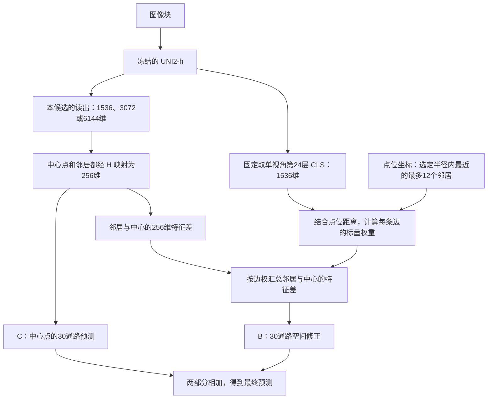

# UNI2-h 冻结读出改版实验分析报告

日期：2026年10月16日。实验：`phase2_uni2h_tuning_20261015`。本轮训练与XZY推理均已完成，回传文件已核查，当前作为待登记的探索结果分析；历史模型结果采用项目已接纳的全视野空间臂记录。

## 阅读前：先回顾模型，再解释两个容易混淆的地方

### UNI2-h先提取图像信息，后面的空间头再预测通路

本项目使用的UNI2-h是一个视觉Transformer，可以把它理解成“把图像拆成小块，让这些小块经过多轮信息交流，最后形成图像特征”的模型。

一张224×224的图像进入模型，先按14×14像素划分，得到16×16＝256个小块，每个小块变成一个1,536维向量，称为patch token。模型还加入1个CLS token和8个register token，总共265个token。这些token一起经过24层Transformer处理，层与层之间不断更新各自的向量。

这里的14×14小块是编码器内部的切分。后面空间图上的一个点，对应一整张224×224图像；图的邻居关系发生在这些点之间。

- **CLS**是专门学习出来的汇总向量，通过与其他token交流获得图像信息。
- **patch token**对应图像中的小块；经过多层处理后，每个向量也融合了其他位置的信息。把256个向量取平均，就得到另一个1,536维图像表示。
- **register token**是模型处理中额外使用的辅助token。本轮patch均值只对256个图像小块取平均。

原基线取第24层CLS作为一张图的表示。本轮还尝试取patch均值、把两者拼接，或从第20、16、12层取出信息。选择不同读出，相当于在同一台已经训练好的图像分析器里，选择不同位置、不同形式的输出。

UNI2-h在本轮全程冻结。它产生的特征交给另外训练的H/C/B空间头，由后者学习怎样预测30条通路。因此报告中说的“空间头”，是本项目接在UNI2-h后面的预测模型。

### 问题一：为什么同种子结果能完全一样？

**这里说的确实是完全一样，范围是三个原基线锚点与历史同种子、同配方的内部结果。** 我们重新核对了两轮保存的原始预测，结果如下；表中列出记录文件保存的完整主指标数值。

| 种子 | 历史内部平均PCC | 本轮锚点内部平均PCC | 两轮所选检查点轮次 | 对齐后逐点预测最大绝对差 |
|---|---:|---:|---:|---:|
| 42 | 0.6791047546922102 | 0.6791047546922102 | 均为26 | 0 |
| 43 | 0.6764861120475478 | 0.6764861120475478 | 均为23 | 0 |
| 44 | 0.6777075383452539 | 0.6777075383452539 | 均为25 | 0 |

为什么这在本实验中是合理的？需要把三种情况分开看：

| 情况 | 随机性或不确定性来自哪里 | 本轮怎样处理 |
|---|---|---|
| 重新训练一个预测头 | 初始权重、训练样本顺序、训练时dropout掩码 | 三者均由明确的随机种子控制；相同种子用于复现相同随机序列 |
| 用已经训练好的权重推理 | 是否在推理时继续随机dropout、随机变换或采样，以及计算实现和环境 | 使用eval模式，关闭dropout；图像变换固定，D4固定遍历8个视角后平均 |
| 判断模型在新患者上是否可靠 | 患者差异、样本代表性和模型误差 | 通过内部与XZY结果、不同种子的表现来观察 |

这个通路回归模型在推理时，按固定的输入、权重和图边权计算一个确定的预测值。它没有在每次推理时抽取一个通路分数，也没有开启用随机dropout反复采样的推理方式。固定推理可以得到同一个数值，同时模型仍然可能预测不准，或在另一位患者上表现不同。

本轮新缓存中的单视角第24层CLS还与旧缓存逐元素相同；原配方、划分、种子及构图方式也一致。在这些条件下，三个锚点复现了历史训练结果。相同种子提供的是可复现的随机序列，逐值一致则由这次原始文件的实际比对确认。换到种子43、44时，预测和指标相应变化，表中的三个PCC已经体现了训练随机性的影响。

报告后面还有另一处“差异为0”：外部推理前，用本轮保存的42个检查点重新计算各自的内部预测，与本轮训练时的预测核对。那是在确认检查点加载和推理流程正确，比较对象是同一个已训练模型的两次推理。

### 问题二：输入特征变了，为什么构图仍用第24层CLS？

每个点在本轮有两份用途不同的图像表示：**一份用于预测，另一份用于给邻居分配权重。** 它们可以采用不同的读出方式，因为承担的计算不同。

以内部首名d4/c20m20为例：用于预测的是第20层CLS与patch均值拼成的3,072维向量，中心点和每个邻居都使用这一套D4平均后的读出。H把它们映射到256维，C预测中心点的通路，B利用邻居与中心的256维差异提供修正。

与此同时，每个点原图的第24层CLS负责计算“这个邻居在形态上与中心有多相似”。选哪些邻居先由坐标、半径和距离排序决定；选定之后，再把距离与CLS余弦相似度合成每条边的权重。**一对1,536维向量比较后，得到的是一个权重数值。** 用这个数值乘256维的邻居差向量，维数就能自然对应起来。

用简化的推理公式表示：

`预测_i = C(h_i) + B[Σ_j a_ij × (h_j − h_i)]`

其中，`h_i = H(本候选读出的中心特征)`，`h_j = H(本候选读出的邻居特征)`；`a_ij`则由固定的单视角第24层CLS、坐标距离和原图参数算出。换成3,072维读出时，变化的是进入H的中心与邻居特征，H的输出仍是256维。

这样安排是为了让这轮实验更容易解释：同一评价划分中，各候选沿用相同的邻居关系和边权，主要观察“用什么特征预测”带来的效果。如果换读出的同时，也用新读出来重新算形态边权，结果就会混合这两种变化。训练集、内部验证集和XZY仍分别建图，各自在自己的点位集合内计算邻居关系。

**这轮实验说明，UNI2-h 原先的表现确实有一部分受特征读出方式影响。** 保持编码器和空间头训练配方不变后，第20层的 CLS 与 patch均值联合读出把内部平均PCC从0.67777提高到0.68434，在XZY上也从0.57307提高到0.58680。另一种方案——只用第24层patch均值——在XZY上达到0.60572，但内部指标下降。两条结果共同表明：UNI2-h里有值得继续利用的信息，而内部验证和另一位患者对这些信息的偏好有所不同。

## 一、为什么开启这个实验

此前的基础模型消融采用同一套冻结空间头配方，替换不同病理编码器。UNI2-h没有表现出预期优势：正式种子45/46/47下，其内部平均PCC为0.67699，低于Virchow2的0.67924；XZY平均PCC为0.57107，低于H-optimus-1的0.59075。这是本轮需要解释和改善的现象。

阶段一拆解发现，UNI2-h的差距有具体位置：内部患者中，相对Virchow2的主要差距来自ZHZ，相对H-optimus-0的主要差距来自TGC；通路方面，差距更多集中在免疫、炎症相关的10条通路。与此同时，各患者的MPP-2图像块均为224×224像素，因此本轮把精力放在“怎样从编码器里取信息”，沿用原图像尺度。

本轮要回答的问题是：**原先只取最后一层CLS汇总向量，是否遗漏了有助于通路预测的信息？改用patch均值、中间层或多视角平均后，UNI2-h能提高多少？** 当前先把UNI2-h做好，再根据结果决定是否让其他模型接受同样的处理。

## 二、实验设计：改了什么，保留了什么

### 1. 整体架构

流程是：图像块 → 冻结的UNI2-h → 特征读出 → 缓存 → 空间预测头 → 30条通路分数。

“冻结”表示UNI2-h本身的权重保持不变。这轮训练的是后面的预测头。预测头包含三个部分：H把输入特征映射到256维，C根据中心点特征输出30条通路分数，B根据邻居与中心的特征差补充空间修正。最后预测等于中心点预测加上空间修正。每种候选、每个种子都重新训练这套预测头。

原基线只把第24层CLS交给预测头。本轮主要改变箭头中间的“特征读出”：换取信息的位置、汇总方式和观察视角，后面的预测头结构沿用原方案。

### 2. 本轮新增的两类变化

本轮同时考察两个因素：**从模型中取哪种特征，以及从几个方向观察图像。** 下文的“第一类”和“第二类”指这两个因素，各种取值交叉组合。

**第一个因素是读出方式。** CLS可以理解为编码器对整块图像形成的一个汇总向量；patch均值则是把图像内部各小块对应的向量取平均。每层patch均值使用256个图像token，排除CLS和8个register token。第12、16、20层读出先经过同一个最终LayerNorm，再交给预测头。

| 代码名 | 实际使用的信息 | 输入维数 |
|---|---|---:|
| c24 | 第24层CLS，原基线锚点 | 1,536 |
| c24m24 | 第24层CLS＋patch均值 | 3,072 |
| m24 | 第24层patch均值 | 1,536 |
| c20m20 | 第20层CLS＋patch均值 | 3,072 |
| c16m16 | 第16层CLS＋patch均值 | 3,072 |
| c12m12 | 第12层CLS＋patch均值 | 3,072 |
| c20m20c24m24 | 第20层与第24层的CLS＋patch均值 | 6,144 |

**第二个因素是观察视角：原图单视角，或D4八视角平均。** 单视角v1直接使用原图；D4把原图及其水平翻转分别旋转0、90、180、270度，得到8个视角。每个视角按同一种读出规则提取向量，再把8个向量按对应维度取平均，交给预测头。这里的D4是这组正方形旋转、翻转变换的数学名称，代码中写作`d4`，其中的4与实验序号无关；本实验实际使用8个视角。

### 为什么要旋转并平均？会怎样影响空间头？

这项设计检验的是：同一块组织换了朝向以后，能否得到更稳定的图像表示。UNI2-h对原图和旋转图可能提取出不同的向量。对8个方向的特征取平均，希望保留多个方向都能识别的信息，减弱特征对朝向的敏感性。

可以把它理解成减少“方向带来的干扰”。这8张图由同一张原图变换而来，染色偏差和模糊也会跟着一起旋转，因此这里的平均主要针对方向敏感性。如果某些方向信息对任务有用，平均也可能削弱它，本轮通过单视角与八视角的成对实验观察实际效果。

**多视角平均会改变空间头的预测，因为中心点和邻居的输入特征都变了。** 同一对邻居仍处于切片上原来的位置，采用原来的边权，但H接收到的是各自的八视角平均特征，所以C的中心预测和B的邻居修正都可能变化。

| 空间头使用的内容 | 使用D4八视角平均后 |
|---|---|
| 中心点的图像特征 | 换成中心点自身8个视角的平均特征 |
| 邻居的图像特征 | 每个邻居也换成其自身8个视角的平均特征 |
| 点位坐标与邻居关系 | 保持原设置，旋转发生在各张图像内部 |
| 图的形态边权 | 仍由单视角第24层CLS及距离计算 |
| 预测头输入维数 | 与同读出的单视角版本相同；平均后每个点仍是一个向量 |

例如，切片上A点旁边是B点，多视角处理后它们仍是邻居。本轮传入空间头的是每张图像的汇总向量，图内token的位置坐标没有传入空间图；图内旋转与切片点位坐标分别处理，二者不会混在一起。

以c20m20为例，单视角的内部平均PCC为0.68412，八视角为0.68434；XZY对应从0.58151升至0.58680。这个对照显示，本轮多视角平均在保持图关系和训练配方一致的条件下带来了额外收益。

### 每一种读出都做了两种视角，共14个候选

**c24、c24m24等7种读出，每一种都分别训练单视角v1和D4八视角平均两个版本。** 第一、第二个因素在所有读出上交叉组合：

| 读出方式 | 原图单视角v1 | D4八视角平均 |
|---|:---:|:---:|
| c24 | 已完成 | 已完成 |
| c24m24 | 已完成 | 已完成 |
| m24 | 已完成 | 已完成 |
| c20m20 | 已完成 | 已完成 |
| c16m16 | 已完成 | 已完成 |
| c12m12 | 已完成 | 已完成 |
| c20m20c24m24 | 已完成 | 已完成 |

例如，`v1/c24`与`d4/c24`比较同一读出的视角平均效果；`v1/c24`与`v1/c24m24`比较同一视角下增加patch均值的效果。组合名称中的`c24`描述读出，`d4`描述视角，两部分各自表达一个因素。

7种读出×2种视角＝14个候选；每个候选训练种子42/43/44，共42次头部训练。一次特征准备保存两种视角的多层缓存，后续训练按需取列。

### 3. 与原基线保持一致的部分

| 项目 | 本轮沿用的设置 |
|---|---|
| 数据与目标 | MPP2/group_2，原30条通路，活动修复v003标签 |
| 划分 | 9,472个训练点；六名开发患者共1,078个内部验证点；XZY共1,039个外部点 |
| 内部验证方式 | 六名开发患者内留出空间区块，沿用原672像素区块划分；六折继续暂缓 |
| 图像输入 | 完整图像块224×224，bicubic处理及ImageNet归一化 |
| 编码器 | 同一UNI2-h权重，全程冻结 |
| 空间头 | H/C/B结构，隐藏维256，GELU，dropout 0.3，B零初始化 |
| 空间图 | 单跳，半径为原生网格步长的2倍，最多12个邻居，原距离与形态权重参数 |
| 构图用的图像特征 | 单视角第24层CLS用于计算邻居的形态相似度及边权；进入H的中心点和邻居特征随候选读出一起变化 |
| 优化器 | Adam，学习率0.0001，weight decay为0，恒定学习率 |
| 批量与精度 | batch size 32，保留末批，FP32，关闭AMP与TF32 |
| 检查点选择 | 内部患者—通路等权平均PCC，同分比较内部z-MSE |
| 训练上限与早停 | 上限120轮；第41轮开始计数，改善阈值0.0001，连续20轮未达到要求则早停 |
| 标签标准化 | 沿用训练集参数，XZY使用该参数对应的标签标度 |

输入维数变化会自然带动H的参数量：输入1,536、3,072、6,144维时，预测头参数量分别为408,862、802,078、1,588,510。因此，这轮衡量的是“某种读出接上原训练配方后，实际能得到怎样的结果”。其中c24和m24维数相同，两者的对照尤其便于观察汇总方式带来的差别。

本轮与历史正式模型比较时还有一个需要放在一起看的变化：本轮使用42/43/44作为筛选种子，历史正式结果使用45/46/47；UNI2-h本轮额外尝试了14种组合，其他三款模型仍使用原读出。后面的跨模型表保留这两类结果，便于判断差距有多大，以及是否值得补齐相同尝试。

### 4. 实际执行情况

先运行单视角c24的三个锚点，再在同批次续跑其余39项。三个锚点与历史42/43/44对应结果的内部主指标、所选轮次完全一致；原始预测按身份对齐后的最大绝对差也均为0，具体数字见开头讲解。全轮实际训练60—110轮，所选检查点位于第11—90轮，早停按原设定正常工作。

内部结果读完后，按用户追加要求，对全部42项正式检查点执行XZY推理，以便一起查看结果。每个检查点都先复算内部预测，再生成XZY预测；42项内部复算与训练时保存的预测最大差异均为0。回传的42份外部预测、模型路径记录及缓存路径记录均齐全。

## 三、重要结果

### 1. 怎样阅读这些数字

下表均为三个种子的均值±样本标准差。

- **平均PCC**：先在每名患者的每条通路上计算点位相关，再对患者和通路等权平均。这是内部选模指标。XZY只有一名患者，因此外部这一列就是该患者30条通路PCC的平均。
- **展平PCC**：把全部点位×30条通路的z分数展平，计算一次整体相关。它反映整体预测模式，与上一种平均方式关注的侧面不同。

同一XZY上三个种子的标准差表示训练随机性带来的波动；跨患者表现如何，需要由更多患者的结果来描述。

### 2. 14个候选的完整表现

| 视角／读出 | 内部平均PCC | 内部展平PCC | XZY平均PCC | XZY展平PCC |
|---|---:|---:|---:|---:|
| v1／c24 | 0.67777 ± 0.00131 | 0.81127 ± 0.00039 | 0.57307 ± 0.00121 | 0.68625 ± 0.00237 |
| v1／c24m24 | 0.67993 ± 0.00086 | 0.81262 ± 0.00048 | 0.58593 ± 0.00304 | 0.69343 ± 0.00379 |
| v1／m24 | 0.66966 ± 0.00036 | 0.80710 ± 0.00028 | 0.60262 ± 0.00089 | 0.70018 ± 0.00400 |
| v1／c20m20 | 0.68412 ± 0.00033 | 0.81459 ± 0.00024 | 0.58151 ± 0.00261 | 0.68935 ± 0.00838 |
| v1／c16m16 | 0.68060 ± 0.00015 | 0.81001 ± 0.00064 | 0.57401 ± 0.00792 | 0.67615 ± 0.01554 |
| v1／c12m12 | 0.66284 ± 0.00088 | 0.79808 ± 0.00038 | 0.49713 ± 0.00092 | 0.62192 ± 0.00408 |
| v1／c20m20c24m24 | 0.68191 ± 0.00087 | 0.81309 ± 0.00057 | 0.58009 ± 0.00674 | 0.68829 ± 0.00327 |
| d4／c24 | 0.68113 ± 0.00129 | 0.81306 ± 0.00003 | 0.57993 ± 0.00356 | 0.69067 ± 0.00397 |
| d4／c24m24 | 0.68260 ± 0.00093 | 0.81432 ± 0.00046 | 0.59242 ± 0.00304 | 0.70103 ± 0.00332 |
| d4／m24 | 0.66996 ± 0.00053 | 0.80767 ± 0.00024 | 0.60572 ± 0.00114 | 0.70916 ± 0.00140 |
| d4／c20m20 | 0.68434 ± 0.00037 | 0.81473 ± 0.00051 | 0.58680 ± 0.00069 | 0.69975 ± 0.00885 |
| d4／c16m16 | 0.68232 ± 0.00013 | 0.81141 ± 0.00126 | 0.58323 ± 0.00378 | 0.67855 ± 0.01488 |
| d4／c12m12 | 0.66678 ± 0.00052 | 0.80055 ± 0.00142 | 0.50081 ± 0.00647 | 0.61788 ± 0.01183 |
| d4／c20m20c24m24 | 0.68382 ± 0.00079 | 0.81404 ± 0.00035 | 0.58526 ± 0.00476 | 0.69159 ± 0.00533 |

### 3. 内部选出的方案，在XZY上也提高了

按既定内部指标，首名是 **D4＋第20层CLS与patch均值（d4/c20m20）**。相对同种子锚点，内部平均PCC提高0.00658，展平PCC提高0.00347；XZY平均PCC提高0.01373，展平PCC提高0.01350。内部和XZY的平均PCC均为三个种子全部提高。

这条结果回答了本轮最初的问题：改变冻结表征的读出方式，确实能在保留原训练配方的情况下提升UNI2-h。内部指标选出的改动，也在这位外部患者上取得了正向结果。

### 4. 第24层patch均值在XZY上更突出，内部排序却不同

**D4＋第24层patch均值（d4/m24）**在XZY的平均PCC为0.60572，比锚点提高0.03265；三个种子分别提高0.03306、0.03013、0.03477。展平PCC提高0.02290，z-MSE从0.61615降至0.54617。

这组结果同时伴随内部平均PCC下降0.00780。单视角m24也呈现同样方向：内部低于锚点，XZY升至0.60262。由此看，patch均值的外部收益在两种视角下都存在。内部验证来自原六名患者的空间区块，XZY来自另一名患者，两种评价条件对读出的偏好出现了分化；今后讨论模型选择时，这一点比单独看一列最高分更有价值。

### 5. 免疫、炎症通路的短板得到改善

阶段一定位的免疫、炎症10条通路，在XZY上从锚点的0.42319提高到d4/m24的0.48742，增加0.06424；其余20条通路从0.64801提高到0.66487，增加0.01686。内部首名d4/c20m20在XZY的免疫组为0.43582，其余组为0.66229。

因此，patch均值对XZY的提升更多出现在原先较弱的免疫、炎症组，改动确实触及了阶段一找到的短板。内部免疫组中，d4/c20m20也从锚点的0.62050升至0.62965。这个分组用于解释结果，检查点始终按全部30条通路的内部主指标选择。

### 6. 主要变化来自读出，D4在此基础上继续增加收益

仅把单视角c24换成单视角c20m20，内部平均PCC已从0.67777升至0.68412；再加D4后为0.68434。对内部首名而言，大部分提升已经由读出改变带来。

在XZY上，c20m20从单视角0.58151升至D4的0.58680，m24从0.60262升至0.60572。本轮7种读出的平均PCC在D4下均高于各自单视角结果。D4对提取阶段增加了8向观察的计算量，现有缓存生成后，后续头部训练和推理使用平均向量。

## 四、与Virchow2、H-optimus-0和H-optimus-1放在一起看

你提到的“Voucher two、H零、H一”，对应历史记录中的 **Virchow2、H-optimus-0、H-optimus-1**。

下面统一采用全视野空间臂。历史四个模型使用正式种子45/46/47，本轮UNI2-h使用筛选种子42/43/44。核对了历史四模型、内外两套评价、三个种子，共24份预测，其评价点位、通路顺序与真实标签均与本轮一致。因此表中的分数可以直接观察同一评价集上的实际差距；读出筛选预算、输入维数与种子差异，则用于解释这些差距来自怎样的实验过程。

| 模型／方案 | 种子 | 内部平均PCC | 内部展平PCC | XZY平均PCC | XZY展平PCC |
|---|---|---:|---:|---:|---:|
| 历史UNI2-h／原读出 | 45/46/47 | 0.67699 ± 0.00040 | 0.81055 ± 0.00023 | 0.57107 ± 0.00331 | 0.68375 ± 0.00153 |
| 历史Virchow2／原读出 | 45/46/47 | 0.67924 ± 0.00046 | 0.81135 ± 0.00092 | 0.57776 ± 0.01101 | 0.67831 ± 0.01341 |
| 历史H-optimus-0／原读出 | 45/46/47 | 0.67886 ± 0.00085 | 0.81047 ± 0.00050 | 0.58148 ± 0.00325 | 0.67539 ± 0.00501 |
| 历史H-optimus-1／原读出 | 45/46/47 | 0.67819 ± 0.00176 | 0.81204 ± 0.00100 | 0.59075 ± 0.00604 | 0.69014 ± 0.01055 |
| 本轮UNI2-h／原读出锚点 | 42/43/44 | 0.67777 ± 0.00131 | 0.81127 ± 0.00039 | 0.57307 ± 0.00121 | 0.68625 ± 0.00237 |
| 本轮UNI2-h／D4＋第20层联合读出（内部首名） | 42/43/44 | 0.68434 ± 0.00037 | 0.81473 ± 0.00051 | 0.58680 ± 0.00069 | 0.69975 ± 0.00885 |
| 本轮UNI2-h／D4＋第24层联合读出 | 42/43/44 | 0.68260 ± 0.00093 | 0.81432 ± 0.00046 | 0.59242 ± 0.00304 | 0.70103 ± 0.00332 |
| 本轮UNI2-h／D4＋第24层patch均值 | 42/43/44 | 0.66996 ± 0.00053 | 0.80767 ± 0.00024 | 0.60572 ± 0.00114 | 0.70916 ± 0.00140 |

### 这张表回答了什么

**第一，按内部指标选出的UNI2-h方案，已经超过历史三款对手的内部双PCC。** d4/c20m20的内部平均PCC分别比Virchow2、H-optimus-0、H-optimus-1高0.00510、0.00549、0.00615。它在XZY的平均PCC也超过Virchow2和H-optimus-0，分别高0.00904和0.00532；与H-optimus-1相比，平均PCC低0.00396，展平PCC高0.00961。内部选出的方案在不同外部指标上呈现了不同的比较方向。

**第二，第24层联合读出提供了另一组值得查看的结果。** d4/c24m24的内部双PCC与XZY双PCC，均高于表中的历史三款对手；其中XZY平均PCC为0.59242，比H-optimus-1高0.00166。这个差距较小，而它在内部和外部都处于较高水平，适合在讨论候选路线时一起保留。

**第三，XZY上patch均值带来的提升幅度更大。** d4/m24比历史Virchow2、H-optimus-0、H-optimus-1的外部平均PCC分别高0.02797、0.02424、0.01497；相对H-optimus-1，展平PCC也高0.01901。它的内部指标低于这些历史模型，所以这组成绩更适合帮助理解“哪种读出在跨到XZY时更有用”。

本轮全部候选的XZY结果已经共同查看。今后若根据这张表决定采用某种读出，XZY便是参与路线探索的依据；新的确认性评价应来自后续独立数据。当前表格用于看清已得到的提升，以及安排哪些对照最有信息量。

## 五、这些成果怎样帮助决定是否补做其他模型

原先的疑问是“为什么UNI2-h没有达到预期优势”。本轮把问题推进了一步：**同一个UNI2-h，换一种取特征的方法，表现就会明显改变；有的改动改善内部和外部，有的改动主要改善跨到XZY后的表现。** 因而，过去那组差距里既包含编码器的差别，也可能包含“现有读出是否适合该编码器”的差别。

若下一步希望回答“Virchow2、H-optimus-0/1经过相同处理后，还会不会领先”，补做同条件读出与视角实验就有直接价值。对照时可以沿用同一划分、标签、种子、H/C/B配方和内部选择规则，并给各编码器相同的候选预算；中间层按各编码器的深度选择可对应的位置。这样得到的是各模型在相近探索条件下的比较。

若先只把UNI2-h某个配置原样迁移给其他模型，则回答的是“这套配置能否迁移”，实验量更小。各编码器对层和汇总方式的偏好可能不同，这两种补实验方式分别服务于不同问题。当前尚未选择其中一条，也未启动其他模型训练。

这轮最值得带入后续讨论的是三组配置：内部首名d4/c20m20、内外两侧均较高的d4/c24m24，以及揭示内外分化的d4/m24。它们让后续比较有了具体参照，六折与其他模型补实验继续按用户决定推进。

## 数据与实现来源

1. [本轮实验计划](../project_state/plans/Phase2病理基础模型消融_UNI2h调优任务_20261014.md)：实验目的、阶段一差距及原比较设置；当前执行进度以本轮实际回传为准。
2. [本轮训练配置](../experiments/phase2_uni2h_tuning_20261015/config.json)、[模型实现](../experiments/phase2_uni2h_tuning_20261015/src/model.py)、[外部推理说明](../experiments/phase2_uni2h_tuning_20261015/external_xzy/README.md)。
3. [内部逐候选结果](../experiments/results/phase2_uni2h_tuning_20261015/20261016_000559_290_6c391127/train-screen_20261016_114943_840_2e1e8ffb/analysis/per_variant.csv)、[内部完整性与锚点复现](../experiments/results/phase2_uni2h_tuning_20261015/20261016_000559_290_6c391127/train-screen_20261016_114943_840_2e1e8ffb/analysis/summary.json)。
4. [XZY逐候选结果](../experiments/results/phase2_uni2h_tuning_20261015/20261016_000559_290_6c391127/external-xzy_20261016_145122_da3e3b29/analysis/per_variant.csv)、[逐种子结果](../experiments/results/phase2_uni2h_tuning_20261015/20261016_000559_290_6c391127/external-xzy_20261016_145122_da3e3b29/analysis/per_task.csv)、[外部推理记录](../experiments/results/phase2_uni2h_tuning_20261015/20261016_000559_290_6c391127/external-xzy_20261016_145122_da3e3b29/task_results.json)。
5. [历史六模型汇总](../experiments/results/phase2_backbone_spatial_ablation_batch2_20260919/20260927_154318_475_2242f53b/analysis/six_model_summary.csv)、[历史逐种子与预测来源](../experiments/results/phase2_backbone_spatial_ablation_batch2_20260919/20260927_154318_475_2242f53b/analysis/six_model_per_seed.csv)、[项目实验登记](../experiments/experiment_registry.json)。
6. 开头架构与分工讲解对应[UNI2-h构造和token读出](../experiments/phase2_uni2h_tuning_20261015/src/uni2h_encoder.py)、[读出与构图特征的分配](../experiments/phase2_uni2h_tuning_20261015/src/stage_runtime.py)、[邻居选择与边权计算](../experiments/phase2_uni2h_tuning_20261015/src/graph.py)、[随机种子与前向计算](../experiments/phase2_uni2h_tuning_20261015/src/train.py)。锚点逐点复现的历史来源是[原空间头搜索动作](../experiments/results/phase2_fullfov_hpo_v1/20260916_231813_101_7b1b9a79/search-spatial_20260917_193357_080_74f0d29c/)，对应三个种子下的 `spatial-11` 原始 `internal_best.npz`。

## 六、建议怎样给另外三款模型补做同条件实验

本节是2026年10月16日按用户要求追加的设计建议，当前只写方案和工作量。六折继续暂缓，本次未启动特征提取、训练或外部推理。

### 1. 推荐方案：每款模型都有同样的14次配置选择机会

**建议让Virchow2、H-optimus-0、H-optimus-1各自完成“7种读出×2种视角×3个种子”。** 三款模型合计新增126项头部训练，UNI2-h现有42项直接纳入比较。这样四款模型都用相同的种子、相同的候选数量和内部选择规则回答同一个问题：采用这套空间头配方时，各自怎样读出特征效果最好。

只给三款模型套上UNI2-h的内部首名配置，工作量是3款×3种子＝9项，但回答的是配置迁移效果。完整补做126项，还能看清其他模型是否同样偏好patch均值、D4或中间层，适合解决当前关心的公平比较问题。

这里对齐的是**同一空间头配方下，各模型的读出和视角探索机会**。`spatial-11`本来就是从UNI2-h上选出的共享配方；若以后要比较各模型分别调到较好状态后的性能，可以再给四款模型相同预算的头部超参数搜索。当前建议先完成读出这一层的对齐，便于与本轮UNI2-h直接衔接。

### 2. 先把“同条件”落实到具体设置

| 项目 | 建议设置 | 这样比较的含义 |
|---|---|---|
| 数据、图像块和标签 | 四模型沿用本轮9,472个训练点、1,078个内部验证点、1,039个XZY点及原30条通路；按患者、切片、点位身份对齐 | 每个模型看到同一评价任务 |
| 图像几何处理 | 全视野224×224、同样的bicubic与固定8向变换 | 视野和视角组合一致 |
| 图像颜色归一化 | UNI2-h和Virchow2沿用各自已登记的ImageNet配置；H-optimus沿用已登记的H-optimus配置 | 保留每个预训练模型原先适用的输入方式，统一的是几何与实验流程 |
| 编码器 | 复用各模型已登记的固定权重版本，全部冻结 | 比较既有模型的表征读出 |
| 筛选种子 | 全部用42/43/44；初始化、样本顺序和dropout使用同一套种子派生规则 | 与本轮UNI2-h形成同种子对照 |
| 训练配方 | H/C/B结构、hidden 256、dropout 0.3、Adam及学习率、batch 32、FP32、上限120轮和原早停规则全部沿用 | 给各模型同一套下游学习规则 |
| 训练损失 | 沿用标准化后通路目标的MSE及原批次归约方式 | 各模型优化相同预测目标 |
| 参数维数 | 保留编码器原生向量维数，H按输入维数调整，输出仍为256维 | 沿用本轮“相同头部结构与配方”的比较方式 |
| 候选预算 | 每款14配置，每配置三个种子；候选清单在读取新增外部结果前写定 | 各模型有相同数量的读出与视角选择机会 |
| 检查点与候选选择 | 每项按内部平均PCC选择检查点，同分按内部z-MSE；每模型按三种子内部平均PCC选择配置，同分按三种子内部z-MSE均值 | 延续本轮UNI2-h的选择依据 |
| 结果统计 | 内部与XZY分别列两种PCC、三个种子的均值及样本标准差，并列同种子相对本模型锚点的增量 | 同时看绝对性能和改版收益 |

Virchow2的原生向量为1,280维，H-optimus-0/1为1,536维。单块、两块、四块拼接时，前者分别为1,280／2,560／5,120维，后两者与UNI2-h一样为1,536／3,072／6,144维。这里选择保留模型原生信息，因此会同时登记预测头参数量、实际训练轮次和耗时，帮助判断提升伴随的成本。若再增加统一投影或修改隐藏维来配平参数，就会引入一组新的结构变化，适合以后单独研究。

### 3. 层数不同，按相对深度对应

其他模型的“第20层”未必与UNI2-h的第20层处于相同深度。建议把本轮12／16／20／24层转换为总深度的 **1/2、2/3、5/6和最后一层**，分别称为中层、较深层、近末层和末层。

代码编写时先读取各模型实际Transformer block数量L，再取最接近这些比例的层，四舍五入取整并按1开始编号。例如，若模型实际为32层，则对应16／21／27／32层；若实际为40层，则对应20／27／33／40层。UNI2-h为24层，恰好恢复本轮12／16／20／24层。实际层号要随特征缓存保存，表中统一用相对深度名称，便于横向阅读。

| 通用读出名称 | 对应本轮UNI2-h配置 |
|---|---|
| 末层CLS | c24 |
| 末层CLS＋patch均值 | c24m24 |
| 末层patch均值 | m24 |
| 近末层CLS＋patch均值 | c20m20 |
| 较深层CLS＋patch均值 | c16m16 |
| 中层CLS＋patch均值 | c12m12 |
| 近末层与末层联合读出 | c20m20c24m24 |

每个读出均做单视角和D4八视角平均。patch均值按各模型实际token布局排除CLS及register token；各层沿用该编码器相应的输出归一化。提取前将“单视角末层CLS”与历史原读出核对，特别是H-optimus原来使用的最终embedding，先确认其实际池化和归一化路径，再接入多层读出。这样新锚点与旧模型使用的是同一种原始表示。

### 4. 构图也保持同一套分工

建议各模型都用**自身单视角末层CLS**计算形态边权，并在自己的14个候选之间固定下来。坐标选邻居、距离权重、半径、邻居上限和温度参数全部一致。进入H的中心点及邻居特征，随该候选的读出一起切换。

例如，Virchow2切换到近末层联合读出时，中心和邻居都使用新的联合特征，但其图的形态权重仍来自Virchow2单视角末层CLS。这与本轮UNI2-h的分工一致，也能衔接各自历史基线。

四模型的形态向量不同，因此形态边权可以不同。主实验比较的是“编码器表征＋自身形态图”接入同一套空间头规则后的系统表现。若以后专门研究图权重的贡献，可以另设四模型共用一张固定图的实验；本次建议先完成与已有UNI2-h对应的这组比较。

### 5. 执行顺序：先核对锚点，再完成全部筛选

1. **准备三款模型的多层缓存。** 每模型提取四个相对深度的CLS和patch均值，分别写单视角、D4两份缓存。单视角就是D4的原图视角，在同一提取流程里一起得到。新缓存按现行规则存入服务器`feature_caches`，保留旧缓存。
2. **先跑三个模型各自的原读出锚点。** 单视角末层CLS×三个种子，共9项。这9项包含在126项内。特征与历史缓存对齐，训练实现与已核实的UNI2-h路径对齐；历史正式种子45/46/47的结果用于观察原有水平，本轮42/43/44形成新的同种子基线。
3. **完成余下117项。** 每模型余下13配置×三个种子，共39项；三模型共117项。各候选从头训练H/C/B，失败任务按原种子重试，保留失败与成功尝试记录。
4. **先完成内部比较并记录各模型内部首名，再做新增XZY推理。** 三款模型的全部126项检查点都保存外部预测，与UNI2-h现有42项一起形成完整的四模型对照。各检查点先复算内部预测，确认加载和前向一致后，再运行XZY。
5. **按两种问题分别汇总。** 一张表比较同一种读出、同一种视角下的四模型；另一张表比较各模型按内部规则选出的首名。同时报告相对各自锚点的提升，区分“原来更强”和“改版收益更大”。

XZY已在现有探索中被查看，本轮新增对照继续服务于这位患者上的差距解释和方案比较。所有候选和选择规则先写定，有助于把新增信息集中在“相同尝试会给其他模型带来什么变化”这个问题上。

### 6. 预计新增实验量

| 工作 | 每款新增模型 | 三款合计 | 如何复用现有UNI2-h |
|---|---:|---:|---|
| 多层特征准备 | 1个提取流程，写2份缓存 | 3个提取流程、6份缓存 | 两份缓存直接复用 |
| 编码器图像前向 | 11,589点×8视角＝92,712次 | 278,136次图像前向 | 已完成部分直接复用 |
| 原读出锚点训练 | 3项 | 9项 | 已有3项 |
| 其余候选训练 | 13配置×3种子＝39项 | 117项 | 已有39项 |
| **头部训练总计** | **42项** | **126项** | **已有42项；四模型共168项** |
| 新增XZY检查点推理 | 42项 | 126项 | 已有42项 |

这里的图像前向数量按单张图像计算，实际可以批量送入GPU；3个提取流程会依次加载不同编码器。每个流程同时保存单视角和八视角平均结果，原图视角共用一次前向。

新缓存的纯FP32特征数组约3.2GB：Virchow2两份约0.95GB，H-optimus-0/1各两份约1.14GB，另加身份和元数据文件。权重和缓存本体继续留在服务器，回传原始预测、日志和路径登记。

时间排程可参照本轮真实运行：UNI2-h八视角特征准备约29.5分钟，续跑39项头部训练约2小时18分钟。按相近头部吞吐估算，新增126项约7.4小时；另三款编码器的实际提取速度和早停轮次需要现场计时。建议先预留RTX 4080约12—24小时的单卡排程，完成第一款模型后用实际耗时更新剩余排程。上述是工作量估算，本次没有新增运行。

### 7. 可选的第二步：用45/46/47复核各模型的内部首名

126项完成后，若希望把“筛选种子上的最好配置”进一步与历史正式结果衔接，可以固定四模型各自的内部首名，统一用45/46/47重新训练并评估XZY。每模型3项，四模型合计最多新增12项头部训练和12项XZY推理；本轮UNI2-h的内部首名也应一并参加。

这样，推荐主方案是**新增126项训练＋126项外部推理**；加上这一可选复核，累计最多**新增138项训练＋138项外部推理**。若某模型内部首名恰好就是原单视角末层读出，且已登记的45/46/47训练与当前配置、图和缓存合同逐项一致，可以复用相应旧结果，实际新增量随之减少。

这一步用未参与本轮读出筛选的种子检查配置对训练随机性的稳定性，数据划分仍沿用当前方案。是否开展这12项，在三款模型同预算筛选完成后再由用户决定。

### 8. 本节方案的最小自检

按项目`pfmval-audit`对方案进行定向自检：实验约定已列明14候选、统一种子与训练配方；数据边界沿用原划分及训练集标准化；学习行为约定编码器冻结、H/C/B重新训练、每模型固定自己的形态图；检查点和候选只按内部规则选择，完整报告内外双PCC及缺失任务。126＝3×7×2×3、138＝126＋4×3，计数与工作表一致。层号、token布局、末层输出路径和GPU耗时在代码编写及服务器运行时按上述方法核实，当前没有新增实验结论。

本节模型原生维数与归一化依据为[H-optimus已登记模型合同](../experiments/phase2_backbone_spatial_ablation_batch2_20260919/src/model_adapters.py)及[Virchow2既有适配实现](../experiments/phase2_fullfov_hpo_v1/src/adapters.py)；时间依据为本轮[特征准备记录](../experiments/results/phase2_uni2h_tuning_20261015/20261015_210752_728_d2b4ce74/prepare-features_20261015_210752_728_d2b4ce74/action_result.json)及[39项续跑时间记录](../experiments/results/phase2_uni2h_tuning_20261015/20261016_000559_290_6c391127/train-screen_20261016_114943_840_2e1e8ffb/run.json)。
