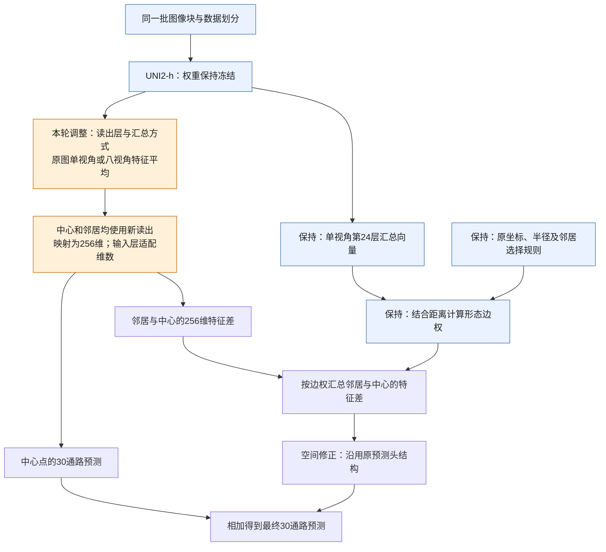

# UNI2-h读出调整实验：结果与后续讨论

2026年10月16日，QZS交接。

**这轮通过调整UNI2-h的特征读出和观察视角，得到了内部验证、XZY外部测试均有提升的方案。其中，第24层联合读出配合八视角平均，在下面四项指标上均高于之前的Virchow2、H-optimus-0和H-optimus-1。** 目前内部训练和外部推理各42项已全部完成，结果回传核对齐全，后续如何补实验及衔接Phase2、Phase3，请李博士结合下述对照条件判断。

## 先说明指标：各自回答什么问题

记$p$为患者、$i$为该患者的点位、$k$为通路；患者数为$P$，通路数$K=30$，患者$p$有$n_p$个点，总点数$N=\sum_p n_p$。$z$为真实标准化分数，$\hat z$为预测值。标准化参数来自训练集：$z=(y-\mu_{\mathrm{train},k})/\sigma_{\mathrm{train},k}$。

| 指标 | 简要公式 | 怎么理解 |
|---|---|---|
| **平均PCC** | $\frac{1}{P}\sum_p\frac{1}{K}\sum_k\operatorname{Corr}_i(\hat z_{pik},z_{pik})$ | 每名患者、每条通路分别看预测与真实的点位变化是否一致，再等权平均。适合看各患者、各通路的平均预测能力；本轮沿用它作为内部选模主指标。 |
| **展平PCC** | $\operatorname{Corr}(\operatorname{vec}(\hat z),\operatorname{vec}(z))$ | 把全部点位×通路的z分数排成两列算一次相关，反映整体模式。点位多的患者贡献更多，也会包含患者间、通路间的分数差异。 |
| **z-MSE** | $\frac{1}{NK}\sum_{p,i,k}(\hat z_{pik}-z_{pik})^2$ | 所有点位、通路的标准化分数误差平方取平均，越小越好。PCC关注变化趋势，这一项补充看预测数值偏离真实值多远。 |
| **患者等权z-MSE** | $\frac{1}{P}\sum_p\frac{1}{n_pK}\sum_{i,k}(\hat z_{pik}-z_{pik})^2$ | 先算每位患者的z-MSE，再让患者等权平均；本轮内部主PCC同分时，用它比较检查点。 |

PCC越高表示变化趋势越一致，MSE越低表示数值误差越小。内部有六名患者，平均PCC让他们各占同样权重；XZY只有一名患者，平均PCC就是它30条通路PCC的平均。两种PCC分别呈现不同侧面，读表时在同一列比较模型。

若需要看原始通路分数的误差，可以用训练集参数逆变换后再报告 **MAE**（平均绝对误差）和 **RMSE**（均方根误差）：$\mathrm{MAE}=\frac{1}{NK}\sum|\hat y-y|$，$\mathrm{RMSE}=\sqrt{\frac{1}{NK}\sum(\hat y-y)^2}$，两者均越小越好，RMSE对较大的单点误差更敏感。下文结果表保留本次重点比较的两种PCC。

## 服务器文件在哪里

实验代码目录（包含独立的XZY外部推理子目录）：

```text
D:\AIPatho\qzs\code\phase2_uni2h_tuning_20261015\
```

本轮训练和XZY推理结果目录：

```text
D:\AIPatho\qzs\runs\phase2_uni2h_tuning_20261015\20261016_000559_290_6c391127\
```

该目录保留了前后两次训练输出、各任务记录，以及10月16日14:51开始的XZY推理输出。模型权重单独保存在：

```text
D:\AIPatho\qzs\weights\phase2_uni2h_tuning_20261015\20261016_000559_290_6c391127\
```

结果目录中有对应的权重路径清单，查具体模型时可由清单定位。

## 这次改了什么

原来只取UNI2-h最后一层对整块图像的汇总向量。这次保留UNI2-h权重不变，做了两大调优改变：

1. 尝试把每个图内小块的平均特征加入输入，或改从不同深度取特征；

2. 每种读出分别做原图单视角和八个旋转、翻转视角的特征平均。共7种读出、2种视角，每个组合训练3个种子，总计42项。


另注明：本项目使用的UNI2-h是一个视觉Transformer，可以把它理解成“把图像拆成小块，让这些小块经过多轮信息交流，最后形成图像特征”的模型。

一张224×224的图像进入模型，先按14×14像素划分，得到16×16＝256个小块，每个小块变成一个1,536维向量，称为patch token。模型还加入1个CLS token和8个register token，总共265个token。这些token一起经过24层Transformer处理，层与层之间不断更新各自的向量。

这里的14×14小块是编码器内部的切分。后面空间图上的一个点，对应一整张224×224图像；图的邻居关系发生在这些点之间。

- **CLS**是专门学习出来的汇总向量，通过与其他token交流获得图像信息。
- **patch token**对应图像中的小块；经过多层处理后，每个向量也融合了其他位置的信息。把256个向量取平均，就得到另一个1,536维图像表示。改变1提到的“每个图内小块的平均特征，就是指这一部分。
- 不同深度提取特征：指的是从不同transfomer层提取上述特征维度，如后面提到的第20层。之前的实验都是从最末尾第24层提取的特征。
- **register token**是模型处理中额外使用的辅助token。本轮patch均值只对256个图像小块取平均。

原基线取第24层CLS作为一张图的表示。本轮还尝试取patch均值、把两者拼接，或从第20、16、12层取出信息。选择不同读出，相当于在同一台已经训练好的图像分析器里，选择不同位置、不同形式的输出。


数据划分、30条通路、标签标准化和空间预测头的训练配方沿用原方案。空间关系仍按原规则计算，变化的是交给预测头的图像特征。

下面沿用完整分析报告的两分支示意图，标出本轮调整的位置。**橙色部分是改动重点；蓝色部分保留原设置。** 预测头每个候选都重新训练，结构和训练配方沿用原方案，输入层按特征维数调整。



图中有两条分工：**上面的分支改变“用什么特征预测”，下面的分支保留“按什么关系给邻居分配权重”。** 中心点和邻居都换成当前候选的读出；原图第24层汇总向量只负责计算形态相似度及边权。八视角旋转发生在各张图像内部，切片上的点位坐标和邻居位置保持原样。

## 结果提高了多少

下表均为三个种子的均值±样本标准差。平均PCC先逐患者、逐通路计算后等权平均；展平PCC将全部点位与通路的标准化分数放在一起计算。内部为六名开发患者的验证点位，外部为XZY一名患者。

| 模型／方案 | 内部平均PCC | 内部展平PCC | XZY平均PCC | XZY展平PCC |
|---|---:|---:|---:|---:|
| 原Virchow2 | 0.67924 ± 0.00046 | 0.81135 ± 0.00092 | 0.57776 ± 0.01101 | 0.67831 ± 0.01341 |
| 原H-optimus-0 | 0.67886 ± 0.00085 | 0.81047 ± 0.00050 | 0.58148 ± 0.00325 | 0.67539 ± 0.00501 |
| 原H-optimus-1 | 0.67819 ± 0.00176 | 0.81204 ± 0.00100 | 0.59075 ± 0.00604 | 0.69014 ± 0.01055 |
| 新UNI2-h：第20层联合读出＋八视角，内部首名 | **0.68434 ± 0.00037** | **0.81473 ± 0.00051** | 0.58680 ± 0.00069 | 0.69975 ± 0.00885 |
| 新UNI2-h：第24层联合读出＋八视角 | 0.68260 ± 0.00093 | 0.81432 ± 0.00046 | **0.59242 ± 0.00304** | **0.70103 ± 0.00332** |

“联合读出”指把整块图像的汇总向量与图内小块的平均向量拼接使用。

按内部规则选出的第20层方案，相对本轮原读出锚点，内部平均PCC从0.67777提高到0.68434，XZY从0.57307提高到0.58680。第24层联合读出的四项均值则都超过表中的历史三款对照，其中XZY平均PCC比H-optimus-1高0.00166。

另外，只用第24层小块平均特征配合八视角，XZY平均PCC达到0.60572，但内部降至0.66996。这个结果说明不同读出在内部患者和XZY上的表现存在分化，值得与前两组一起讨论。

## 对照条件发生了什么变化，接下来请判断什么

本轮UNI2-h额外筛选了14种组合，上表挑出了其中最优的两款组合。其他三款模型仍是之前的原读出结果；新联合读出的输入维数从1,536增至3,072，预测头参数量也随之增加，八视角还增加了特征提取量。本轮随机种子为42/43/44，历史对照为45/46/47。四款模型使用的评价点位、真实标签和通路顺序已核对一致，表格展示的是这些不同处理条件下的实际成绩。

请李博士据此判断：

1. **是否补做其他基础模型的相同处理？** 若希望各模型拥有同样的选择机会，可给Virchow2、H-optimus-0/1各补7种读出×2种视角×3种子，共126项训练，再视需要扩展其他模型（7种读出是我这边GPT我感觉有点麻烦了，尽管这样做确实更加严谨，但真这么做，似乎phase2其它消融实验也得按照这个新模型来重做才比较严谨？）。若只验证UNI2-h配置能否迁移，实验量可缩小。
2. **Phase2采用怎样的对照口径？** 是保留原来的共享配方模型消融，并把本轮列为UNI2-h改进实验；还是补齐其他模型后，再更新同条件比较表；或者是直接把上面新训练的模型作为新的消融实验基线模型，用来在论文中说明确实UNI2-h最优？
3. **是否影响Phase3？** 当前Phase3沿用既有模型与交接安排。这次结果供决定是否更新特征读出及相应预测头、检查点和输入维数；六折及其他模型补实验也等本次讨论后安排。
4. 还有就是上面提到的两款新UNI2-h模型选择哪款呢？个人倾向于在外边测试集XZY结果更好的“新UNI2-h：第24层联合读出＋八视角 ”模型，更能体现泛化性


本轮XZY已用于共同查看全部候选。后续根据这些结果调整路线时，将其作为探索依据；新的独立数据可以承担后续确认。更详细的实验架构、全部候选及补实验建议见[完整分析报告](../../03分析报告/UNI2h冻结读出改版实验分析报告_20261016.md)。
