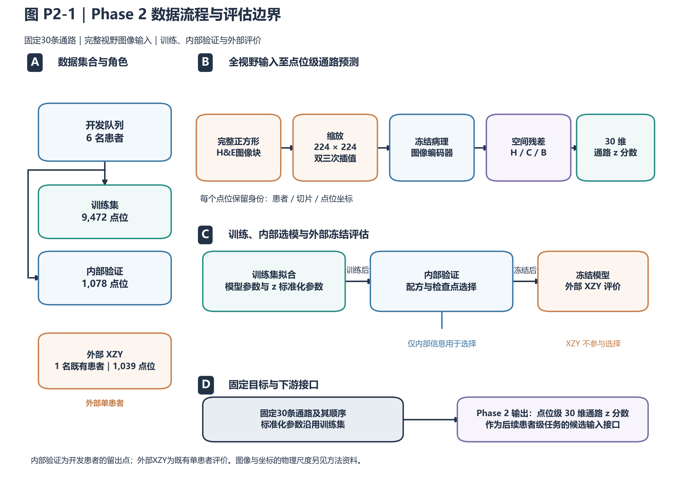
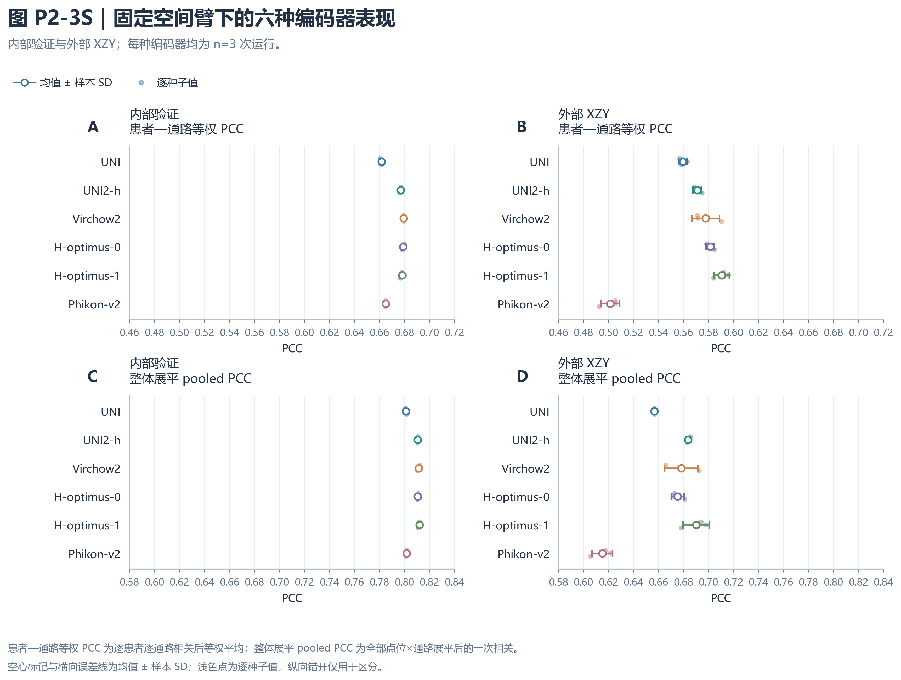
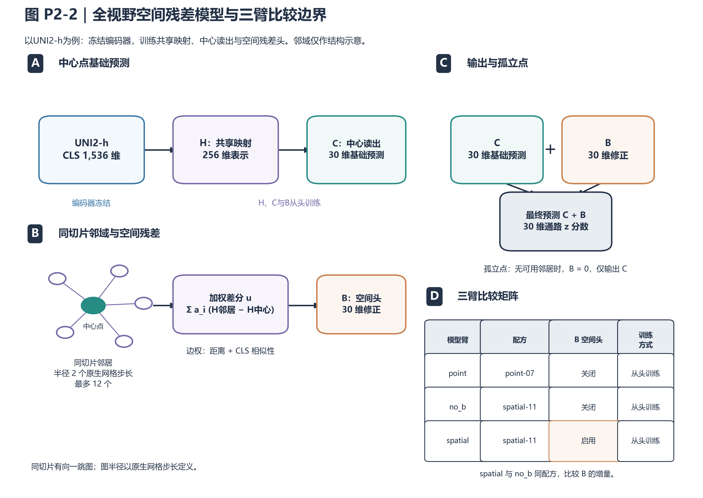
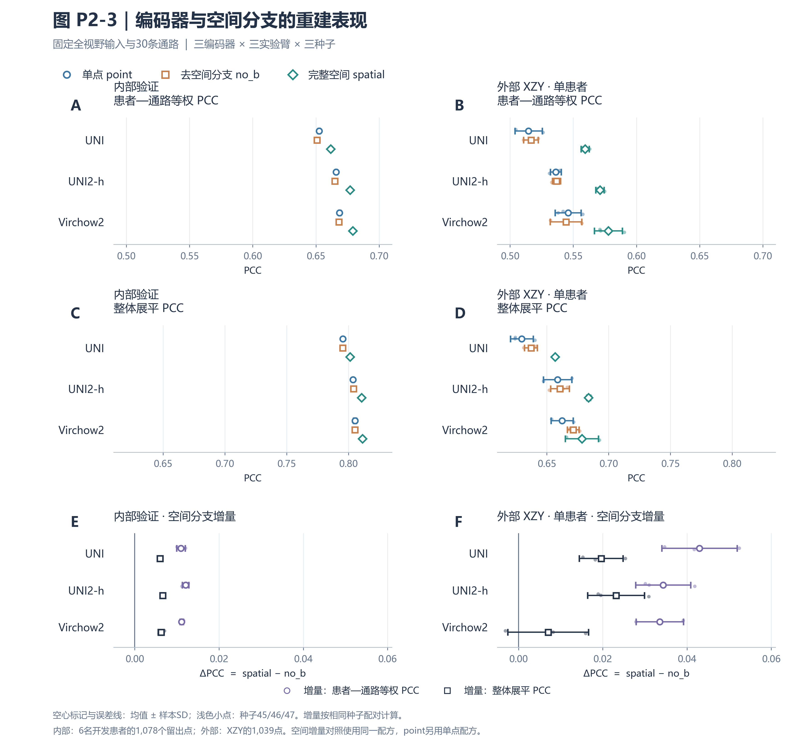
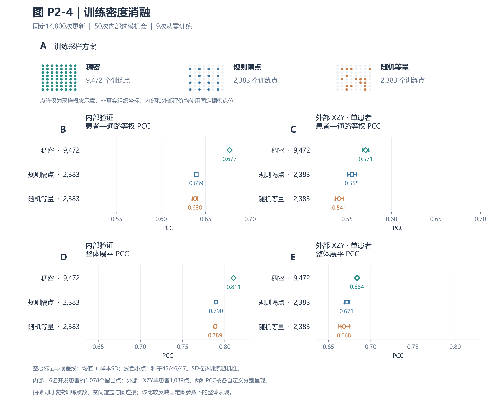
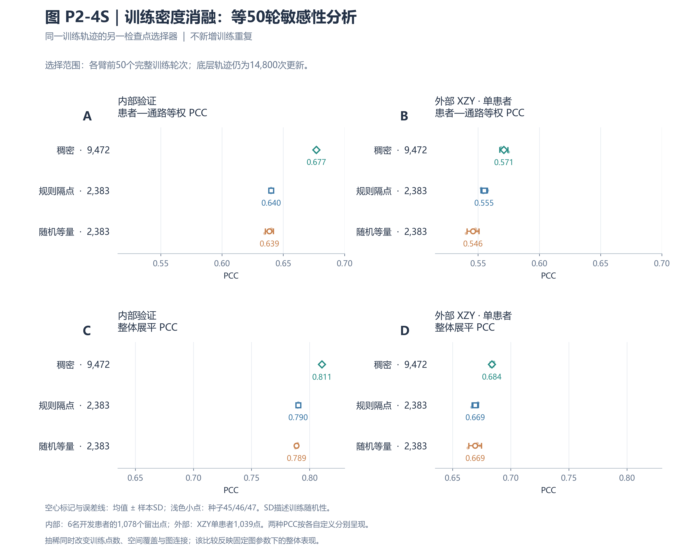
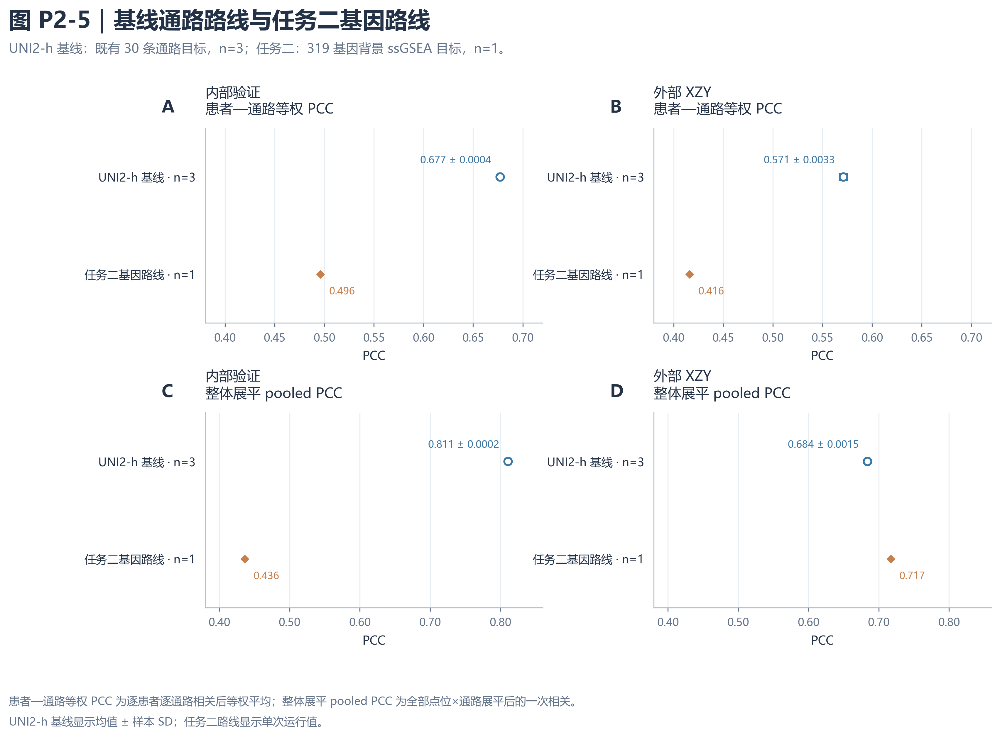

# Phase 2: Pathway-score reconstruction from full-field pathology images with spatial-residual modeling

> English draft v2 | 28 September 2026. This text retains the first-batch three-arm and training-density analyses and adds the six-encoder spatial-arm and single-run gene-route results. Five first-batch figures retain their review versions. [To be completed] marks author edits; citation IDs are provisional in [proposed references](Phase2拟引用文献.md).

## Phase 2 paragraph for the abstract

We developed a spatial-residual model based on full-field H&E images and frozen pathology encoders to reconstruct location-level 30-dimensional pathway scores. The development data comprised 9,472 training and 1,078 internal-validation locations from six patients; evaluation also covered 1,039 locations from the previously studied external patient XZY. For the first three encoders, the complete spatial model achieved higher mean internal and external patient–pathway macro-averaged Pearson correlation coefficients (PCCs) than its matched control without the spatial branch; on fixed dense evaluation sets, dense training yielded higher mean PCCs than two subsampling schemes. Among six encoders evaluated with the frozen spatial recipe, H-optimus-1 had the highest XZY means for patient–pathway macro-averaged and pooled PCC: 0.5908 ± 0.0060 and 0.6901 ± 0.0106 across three seeds. We also report one gene-prediction-to-pathway reconstruction run. These observations are specific to the present data; cross-patient transferability and downstream treatment-response value require further study.

## Background

Estimating spatial molecular phenotypes from routine H&E (hematoxylin and eosin) images provides a research route for linking tissue morphology to molecular measurements. ST-Net examined the feasibility of predicting spatial gene expression from tissue images in breast tumors, and Hist2ST further combined image, positional, and graph-structured information to model spatial expression. These studies provide methodological precedents for supervised learning from images to molecular measurements, but their results do not directly establish pathway-reconstruction capability in esophageal squamous cell carcinoma in the present study. [P2-R1](Phase2拟引用文献.md#p2-r1), [P2-R2](Phase2拟引用文献.md#p2-r2)

We used an existing set of 30-dimensional pathway scores as location-level prediction targets and sought image-derived pathway features that could be used in subsequent patient-level analyses. Rather than only comparing the absolute performance of different models, we addressed three related questions: whether replacing the pathology encoder changes reconstruction performance under consistent input and target definitions; whether adding a neighborhood spatial residual provides information beyond the central-location representation; and how performance changes on fixed dense evaluation sets after training locations are subsampled. The first comparison batch included UNI, UNI2-h, and Virchow2; their sources were the UNI paper, the official UNI2-h model documentation, and the Virchow2 preprint, respectively. [P2-R3](Phase2拟引用文献.md#p2-r3), [P2-R4](Phase2拟引用文献.md#p2-r4), [P2-R5](Phase2拟引用文献.md#p2-r5)

To address these questions, we conducted the first-batch three-encoder, three-arm comparison and a separate training-density ablation, then evaluated three additional encoders with the frozen spatial recipe. A first single-run gene-prediction-to-pathway result is presented alongside the existing direct-pathway model descriptively, with each target-construction workflow specified separately.

## Results

### Data composition and pathway-reconstruction workflow

The current analysis used 10,550 locations from 6 development patients to construct the training and internal-validation sets, including 9,472 locations for training and 1,078 for internal validation; 1,039 locations from the previously evaluated patient XZY were additionally used for external evaluation (Table P2-1). Internal validation consisted of held-out locations from the development patients and therefore evaluates spatial holdout performance within the same development cohort, rather than performance in completely independent patients. XZY was evaluated after model freezing in this round and had been used for historical evaluation; it cannot be treated as a newly acquired blinded test cohort.

The complete square H&E image patch at each location was resized to 224 × 224, processed by a frozen encoder to extract image features, and then used by a central readout and spatial-residual branch to generate 30-dimensional pathway predictions. Pathway-normalization parameters were fitted only on the training set and carried forward to internal and external evaluation. Model selection used internal-validation information only (Figure P2-1).

**Table P2-1 | Phase 2 data composition and use.**

| Set | Patient scope | Number of locations | Use |
|---|---|---:|---|
| Training | 6 development patients | 9,472 | Model fitting and training-set pathway normalization |
| Internal validation | Held-out locations from the same 6 development patients | 1,078 | Recipe and checkpoint selection; internal evaluation |
| External XZY | 1 previously evaluated external patient | 1,039 | Evaluation after freezing |

**Figure P2-1 | Phase 2 data workflow and evaluation boundaries.** A, Six development patients contributed 9,472 training locations and 1,078 held-out internal-validation locations; external evaluation used 1,039 locations from the previously evaluated patient XZY. B, Complete square H&E image patches were resized to 224 × 224 by bicubic interpolation, processed by a frozen pathology encoder to extract features, and then used to predict 30-dimensional pathway z scores. C, Pathway-normalization parameters were fitted only on the training set, and recipe and checkpoint selection were based only on internal validation. D, The fixed pathway order and training-set normalization parameters form the downstream interface. Training and internal validation originate from the same development cohort, and external results are limited to the single patient XZY.

### Encoder comparison shows metric-dependent performance ordering

For the complete spatial arm, the internal patient–pathway macro-averaged PCCs for UNI, UNI2-h, and Virchow2 were 0.6618 ± 0.0010, 0.6770 ± 0.0004, and 0.6792 ± 0.0005, respectively; the corresponding pooled PCCs were 0.8012 ± 0.0004, 0.8105 ± 0.0002, and 0.8113 ± 0.0009 (Table P2-2A). In XZY, the patient–pathway macro-averaged PCCs were 0.5594 ± 0.0032, 0.5711 ± 0.0033, and 0.5778 ± 0.0110, respectively, whereas the pooled PCCs were 0.6568 ± 0.0001, 0.6837 ± 0.0015, and 0.6783 ± 0.0134 (Table P2-2B).

Accordingly, Virchow2 had the higher mean external patient–pathway macro-averaged PCC, whereas UNI2-h had the higher mean pooled PCC. The complete UNI2-h spatial arm also had a lower external pooled zMSE of 0.6330 ± 0.0069. Because the two PCCs use different aggregation schemes, these results indicate that relative encoder ordering depends on the statistical object being evaluated; a single metric cannot be used to summarize one encoder as comprehensively superior to the others. All comparisons were completed using recipes fixed in advance and do not represent a comparison of fully optimized performance after separate extensive tuning for each encoder.

**Table P2-2A | Three-encoder, three-arm comparison: internal validation.**

| Encoder | Experimental arm | Patient–pathway macro-averaged PCC | Pooled PCC | Pooled zMSE |
|---|---|---|---|---|
| UNI | Point (`point`) | 0.6525 ± 0.0008 | 0.7955 ± 0.0001 | 0.3783 ± 0.0006 |
| UNI | No spatial branch (`no_b`) | 0.6508 ± 0.0002 | 0.7952 ± 0.0005 | 0.3781 ± 0.0007 |
| UNI | Complete spatial (`spatial`) | 0.6618 ± 0.0010 | 0.8012 ± 0.0004 | 0.3686 ± 0.0003 |
| UNI2-h | Point (`point`) | 0.6660 ± 0.0005 | 0.8037 ± 0.0004 | 0.3645 ± 0.0007 |
| UNI2-h | No spatial branch (`no_b`) | 0.6649 ± 0.0004 | 0.8039 ± 0.0003 | 0.3637 ± 0.0005 |
| UNI2-h | Complete spatial (`spatial`) | 0.6770 ± 0.0004 | 0.8105 ± 0.0002 | 0.3528 ± 0.0004 |
| Virchow2 | Point (`point`) | 0.6687 ± 0.0009 | 0.8052 ± 0.0012 | 0.3625 ± 0.0032 |
| Virchow2 | No spatial branch (`no_b`) | 0.6681 ± 0.0005 | 0.8051 ± 0.0003 | 0.3627 ± 0.0006 |
| Virchow2 | Complete spatial (`spatial`) | 0.6792 ± 0.0005 | 0.8113 ± 0.0009 | 0.3518 ± 0.0016 |

**Table P2-2B | Three-encoder, three-arm comparison: external XZY.**

| Encoder | Experimental arm | Patient–pathway macro-averaged PCC | Pooled PCC | Pooled zMSE |
|---|---|---|---|---|
| UNI | Point (`point`) | 0.5147 ± 0.0108 | 0.6297 ± 0.0093 | 0.7347 ± 0.0164 |
| UNI | No spatial branch (`no_b`) | 0.5165 ± 0.0058 | 0.6371 ± 0.0052 | 0.7136 ± 0.0160 |
| UNI | Complete spatial (`spatial`) | 0.5594 ± 0.0032 | 0.6568 ± 0.0001 | 0.6808 ± 0.0137 |
| UNI2-h | Point (`point`) | 0.5362 ± 0.0043 | 0.6587 ± 0.0115 | 0.6793 ± 0.0101 |
| UNI2-h | No spatial branch (`no_b`) | 0.5367 ± 0.0032 | 0.6606 ± 0.0076 | 0.6769 ± 0.0029 |
| UNI2-h | Complete spatial (`spatial`) | 0.5711 ± 0.0033 | 0.6837 ± 0.0015 | 0.6330 ± 0.0069 |
| Virchow2 | Point (`point`) | 0.5459 ± 0.0103 | 0.6623 ± 0.0090 | 0.7092 ± 0.0143 |
| Virchow2 | No spatial branch (`no_b`) | 0.5442 ± 0.0124 | 0.6713 ± 0.0047 | 0.7005 ± 0.0159 |
| Virchow2 | Complete spatial (`spatial`) | 0.5778 ± 0.0110 | 0.6783 ± 0.0134 | 0.6834 ± 0.0343 |

All values in Table P2-2 are the mean ± sample SD for seeds 45/46/47. The patient–pathway macro-averaged PCC is the equally weighted average of correlations calculated within each patient and pathway; pooled PCC is calculated once after flattening z scores across all locations × pathways. Pooled zMSE is the mean squared error across all locations × pathways on the same z-score scale. The point arm uses the point recipe, whereas no_b and spatial use the same spatial recipe; all three experimental arms were trained from scratch.

### Six encoders evaluated with the frozen spatial recipe

The second batch connected H-optimus-0, H-optimus-1, and Phikon-v2 to the first batch's fixed full-field spatial prediction architecture. Each of the six encoders had spatial-arm results for seeds 45/46/47 (Table P2-5; Supplementary Figure P2-3S). The internal patient–pathway macro-averaged PCC means ranged from 0.6618 to 0.6792; XZY means ranged from 0.5013 to 0.5908. H-optimus-1 had the highest XZY means for both PCC definitions within this fixed-recipe six-encoder set, 0.5908 and 0.6901; its internal means were 0.6782 and 0.8120. Phikon-v2 had internal means of 0.6650 and 0.8019 and XZY means of 0.5013 and 0.6150. Encoder ordering varied by split and metric. The previously designated UNI2-h seed-45 model retained its downstream-delivery identity.

**Table P2-5 | Full-field spatial-arm results for six frozen encoders.** Values are mean ± sample SD across three seeds; internal validation includes 1,078 locations and external XZY 1,039 locations.

| Encoder | Set | Patient–pathway macro PCC | Pooled PCC | Pooled zMSE |
|---|---|---:|---:|---:|
| UNI | Internal validation | 0.6618 ± 0.0010 | 0.8012 ± 0.0004 | 0.3686 ± 0.0003 |
| UNI2-h | Internal validation | 0.6770 ± 0.0004 | 0.8105 ± 0.0002 | 0.3528 ± 0.0004 |
| Virchow2 | Internal validation | 0.6792 ± 0.0005 | 0.8113 ± 0.0009 | 0.3518 ± 0.0016 |
| H-optimus-0 | Internal validation | 0.6789 ± 0.0009 | 0.8105 ± 0.0005 | 0.3532 ± 0.0009 |
| H-optimus-1 | Internal validation | 0.6782 ± 0.0018 | 0.8120 ± 0.0010 | 0.3506 ± 0.0022 |
| Phikon-v2 | Internal validation | 0.6650 ± 0.0004 | 0.8019 ± 0.0006 | 0.3674 ± 0.0012 |
| UNI | External XZY | 0.5594 ± 0.0032 | 0.6568 ± 0.0001 | 0.6808 ± 0.0137 |
| UNI2-h | External XZY | 0.5711 ± 0.0033 | 0.6837 ± 0.0015 | 0.6330 ± 0.0069 |
| Virchow2 | External XZY | 0.5778 ± 0.0110 | 0.6783 ± 0.0134 | 0.6834 ± 0.0343 |
| H-optimus-0 | External XZY | 0.5815 ± 0.0032 | 0.6754 ± 0.0050 | 0.6165 ± 0.0124 |
| H-optimus-1 | External XZY | 0.5908 ± 0.0060 | 0.6901 ± 0.0106 | 0.5788 ± 0.0069 |
| Phikon-v2 | External XZY | 0.5013 ± 0.0075 | 0.6150 ± 0.0082 | 0.7640 ± 0.0306 |

**Supplementary Figure P2-3S | Pathway reconstruction by six encoders under the frozen spatial recipe.** Internal validation and XZY are shown separately for patient–pathway macro-averaged and pooled PCC. Markers and error bars indicate the mean ± sample SD for seeds 45/46/47. All encoders used full-field 224 × 224 images and the spatial arm; the two PCCs retain their separate aggregation definitions.

### The spatial-residual branch increased mean correlation in the matched-recipe control

The complete spatial model adds a neighborhood residual B to the central prediction C, with final output C+B (Figure P2-2). To distinguish the spatial branch from the training recipe, we compared the complete spatial arm, spatial, with the no_b arm, which used the same spatial recipe but turned off B and retrained.

In the order UNI, UNI2-h, and Virchow2, the mean internal patient–pathway macro-averaged PCC gains of spatial over no_b were 0.0109, 0.0121, and 0.0111, and the pooled PCC gains were 0.0060, 0.0066, and 0.0062, respectively; the corresponding external gains were 0.0430, 0.0343, and 0.0335, and 0.0196, 0.0231, and 0.0070 (Figure P2-3E/F). The complete spatial arms for all three encoders also had lower mean internal and external pooled zMSE values than their respective no_b controls. The direction of these comparisons supports additional predictive information from the spatial branch in the current comparison, but variation across three seeds describes training randomness only and cannot establish statistically significant improvement in a patient population.

**Figure P2-2 | Full-field spatial-residual model and three-arm comparison.** A, Using UNI2-h as an example, the frozen encoder extracts a 1,536-dimensional CLS feature; the shared mapping H produces a 256-dimensional representation, and the central readout C generates a 30-dimensional base prediction. B, A same-slide directed one-hop neighborhood has a radius of 2 native grid steps and includes at most 12 neighbors; the spatial head B maps neighbor-minus-center H feature differences, weighted by distance and CLS similarity, to a 30-dimensional correction. C, The output is C+B; no spatial correction is made when no usable neighbor is available. D, point uses the point-07 recipe, whereas no_b and spatial use the same spatial-11 recipe and are trained from scratch; comparison of the latter two describes the increment associated with branch B. The neighborhood is a structural schematic only.

**Figure P2-3 | Pathway-reconstruction performance of three encoders and the spatial branch.** A/B, Patient–pathway macro-averaged PCC for internal validation and external XZY; C/D, the corresponding pooled PCC. E/F, spatial−no_b gains paired by the same seed, shown separately for the two PCC definitions. Open markers and error bars show the mean ± sample SD for seeds 45/46/47; pale points are individual seed values, and vertical offsets are used only to facilitate viewing. The SD of each gain was calculated from the three paired differences. Internal validation consists of 1,078 held-out locations from 6 development patients, and external evaluation consists of 1,039 locations from XZY. spatial and no_b use the same spatial recipe, whereas point uses a different recipe; the magnitudes of the two PCC definitions cannot mutually establish prediction superiority.

### Dense training achieved higher mean correlation on fixed dense evaluation sets

The training-density ablation compared dense training, regular 2×2 subsampling, and patient-wise random equal-count training, with 9,472, 2,383, and 2,383 training locations, respectively. All models were trained from scratch and evaluated on the same dense internal-validation set and XZY locations. In the primary analysis with 14,800 fixed updates, the dense arm had an internal patient–pathway macro-averaged PCC of 0.6770 ± 0.0004 and pooled PCC of 0.8105 ± 0.0002; the corresponding values were 0.6394 ± 0.0005 and 0.7895 ± 0.0004 for regular subsampling, and 0.6381 ± 0.0030 and 0.7886 ± 0.0013 for random equal-count sampling (Table P2-3).

In XZY, patient–pathway macro-averaged PCCs for dense, regular subsampling, and random equal-count sampling were 0.5711 ± 0.0033, 0.5554 ± 0.0049, and 0.5412 ± 0.0044, respectively; their pooled PCCs were 0.6837 ± 0.0015, 0.6715 ± 0.0030, and 0.6683 ± 0.0061. The dense arm also had lower mean zMSE and MAE on the original-score scale. These results show that, with the current model, fixed graph parameters, and computational budget, dense training achieved better mean predictive performance on both evaluation sets (Figure P2-4). Because subsampling simultaneously changes the number of training locations, spatial coverage, and graph connectivity, this result reflects their combined effects.

**Table P2-3 | Training-density ablation under equal numbers of updates.**

| Set | Training scheme | Number of training locations | Patient–pathway macro-averaged PCC | Pooled PCC | Pooled zMSE | MAE on original-score scale |
|---|---|---:|---|---|---|---|
| Internal validation | Dense | 9,472 | 0.6770 ± 0.0004 | 0.8105 ± 0.0002 | 0.3528 ± 0.0004 | 847.48 ± 1.07 |
| Internal validation | Regular 2×2 subsampling | 2,383 | 0.6394 ± 0.0005 | 0.7895 ± 0.0004 | 0.3878 ± 0.0005 | 905.10 ± 1.06 |
| Internal validation | Patient-wise random equal-count sampling | 2,383 | 0.6381 ± 0.0030 | 0.7886 ± 0.0013 | 0.3887 ± 0.0021 | 903.02 ± 2.04 |
| External XZY | Dense | 9,472 | 0.5711 ± 0.0033 | 0.6837 ± 0.0015 | 0.6330 ± 0.0069 | 1145.34 ± 18.41 |
| External XZY | Regular 2×2 subsampling | 2,383 | 0.5554 ± 0.0049 | 0.6715 ± 0.0030 | 0.6431 ± 0.0088 | 1163.57 ± 15.41 |
| External XZY | Patient-wise random equal-count sampling | 2,383 | 0.5412 ± 0.0044 | 0.6683 ± 0.0061 | 0.6573 ± 0.0320 | 1177.84 ± 46.42 |

Values are the mean ± sample SD for seeds 45/46/47. Internal and external location counts remained 1,078 and 1,039, respectively; error evaluation was returned to the z-score scale defined by the dense training set for all arms, whereas MAE was calculated on the original pathway-score scale. The dense arm and the main-experiment UNI2-h spatial arm retain their respective run sources and were not merged to increase the number of replicates.

**Figure P2-4 | Training-density ablation on fixed dense evaluation sets.** A, Conceptual sampling schematic for dense training, regular 2×2 subsampling, and patient-wise random equal-count training; the dot grid does not correspond to coordinates from a real tissue section. B/C show internal and external patient–pathway macro-averaged PCC, and D/E show pooled PCC. Each arm was trained from scratch with seeds 45/46/47, 14,800 fixed updates, early stopping disabled, and internal validation every 296 updates, providing 50 internal selection opportunities. Internal and external evaluation sets remained dense. Markers and error bars show mean ± sample SD, pale points are individual seed values, and numerical labels retain three decimal places. Subsampling simultaneously changes the number of training locations, spatial coverage, and training-graph connectivity.

On the same training trajectories, when checkpoint selection was restricted to the first 50 complete training epochs for each arm, the dense arm still had higher mean values for both PCC definitions in internal and external evaluation than either sparse arm (Supplementary Figure P2-4S). This sensitivity result retained the direction of the primary comparison; it is an alternative checkpoint selection from the same training batch and cannot be treated as an independent replicate.

**Supplementary Figure P2-4S | Equal-50-epoch sensitivity analysis for the training-density ablation.** The same nine training trajectories as in Figure P2-4 were used, with internal validation to select a checkpoint within the first 50 complete training epochs of each arm. A/B show patient–pathway macro-averaged PCC for internal validation and XZY, and C/D show pooled PCC. Points, error bars, and seed conventions are the same as in Figure P2-4. The underlying trajectories each had 14,800 updates; this figure does not add training batches or replicates.

### Single-run pathway reconstruction after gene prediction

Task 2 transformed the 319 predicted gene outputs from one source run into 30 pathway predictions. Across 1,078 internal-validation locations, patient–pathway macro-averaged PCC was 0.4961 and pooled PCC was 0.4361; across 1,039 XZY locations, the corresponding values were 0.4160 and 0.7170 (Table P2-4). Internal and external pooled zMSE were 1.7985 and 0.8333, and mean absolute error (MAE) on the reconstructed ES scale was 31.8383 and 20.8717, respectively. Figure P2-5 places this single gene-route run beside the existing UNI2-h spatial model evaluated on its V003 target.

**Table P2-4 | Descriptive juxtaposition of gene-to-pathway reconstruction and the existing spatial model.** The gene route has one run; the UNI2-h spatial arm is shown as mean ± sample SD across three seeds. The routes use 319-gene reconstructed scores and the existing V003 target, respectively.

| Route | Set | Locations | Runs | Patient–pathway macro PCC | Pooled PCC |
|---|---|---:|---:|---:|---:|
| Gene-to-pathway reconstruction | Internal validation | 1,078 | 1 | 0.4961 | 0.4361 |
| UNI2-h spatial arm | Internal validation | 1,078 | 3 | 0.6770 ± 0.0004 | 0.8105 ± 0.0002 |
| Gene-to-pathway reconstruction | External XZY | 1,039 | 1 | 0.4160 | 0.7170 |
| UNI2-h spatial arm | External XZY | 1,039 | 3 | 0.5711 ± 0.0033 | 0.6837 ± 0.0015 |

**Figure P2-5 | Descriptive juxtaposition of two pathway prediction routes.** The gene route uses ssGSEA/ES scores reconstructed in a 319-gene background, with one source run and no across-run error bar. The direct pathway route uses the existing V003 target and the UNI2-h spatial model, shown as mean ± sample SD for seeds 45/46/47. Internal and XZY results are shown for both PCC definitions.

## Discussion

The Phase 2 results indicate that, under fixed full-field input and 30-dimensional pathway targets, pathology-image representations can support location-level pathway-score reconstruction, and both the spatial-residual branch and training-sampling scheme are associated with predictive performance. The complete spatial arms of all three encoders had higher mean internal and external values for both PCC definitions than their matched-recipe no_b controls, and dense training outperformed both sparse schemes on both evaluation sets. These observations provide experimental support for the current model setting while limiting its applicability to this study’s data and comparison protocol.

The six-encoder spatial-arm set broadens the representation comparison under a fixed recipe. H-optimus-1 had the highest XZY means for both PCCs, while internal rankings and error metrics were not identical. The spatial-11 recipe was initially selected on UNI2-h internal validation, so its application to additional encoders evaluates a shared setting rather than each encoder's individually tuned ceiling. The designated downstream UNI2-h seed-45 model was not replaced on the basis of second-batch external results.

The descriptive juxtaposition in Figure P2-5 shows lower internal PCCs by both definitions and lower external patient–pathway macro PCC for the gene route than the existing UNI2-h spatial-model means, whereas external pooled PCC was higher. The aggregation measures thus show different directions and do not establish overall superiority of either route.

The role of the spatial branch can be understood as supplementing the central prediction. The central readout uses only the image at the current location, whereas branch B receives neighbor-minus-center representation differences and can therefore incorporate local tissue context into the prediction. The joint modeling of image and spatial structure is consistent with the direction of prior spatial-expression prediction research, but this study did not directly validate specific cell-composition or molecular-mechanism explanations; the gain from the spatial branch should therefore remain a model-level observation. [P2-R2](Phase2拟引用文献.md#p2-r2) Because the point arm uses a different recipe from the spatial recipe, interpretation of branch B should rest on the paired spatial versus no_b comparison.

The encoder comparison shows that patient–pathway macro-averaged PCC and pooled PCC can yield different orderings. The former weights patients and pathways equally, whereas the latter evaluates the overall correlation structure of all standardized location–pathway entries. The different external ordering of Virchow2 and UNI2-h indicates that the two summaries do not answer exactly the same question. We therefore report both PCC definitions and error metrics in parallel rather than generalizing an advantage on one metric to all dimensions of prediction. The UNI2-h spatial-model seed 45 used for downstream delivery was specified before external evaluation; its use was not based on post hoc selection of the encoder or seed with the best external performance.

The density ablation supports retaining dense training information, but the observed difference cannot yet be attributed to the number of locations alone. The regular-subsampling and random-equal-count arms both reduce training samples and alter spatial coverage and training neighborhoods; a fixed graph radius also changes the available connections after subsampling. Although the equal-updates primary analysis and equal-50-epoch sensitivity analysis had consistent directions, they share the same data and training trajectories. Separately identifying the contributions of sample count, spatial coverage, and neighborhood connectivity will require specifically designed control experiments.

This study has several limitations. First, internal validation and training originate from the same development patients, and external evaluation includes only one previously evaluated patient; patient-to-patient or cross-center generalization uncertainty cannot be estimated from these data. Second, statistics across three seeds reflect training randomness only and are insufficient for significance inference in a patient population. Third, the fixed-recipe comparison did not optimize each encoder comprehensively; observed ordering is also influenced by recipe fit. The original pathway-scoring algorithm, gene-set membership, and physical image coverage remain to be completed in the source materials, and these details are relevant to biological interpretation of the target and the boundary of spatial evaluation. 

As an input interface for Phase 3, this phase delivers location-level 30-dimensional pathway z scores together with patient, slide, and location identities and training-set normalization parameters. Subsequent work will evaluate whether this representation provides information beyond pathology morphology for patient-level treatment-response prediction; until the corresponding results are available, conclusions from this phase concern pathway reconstruction only and do not address clinical-prediction benefit.

## Methods

### Study materials, identity linkage, and data partitioning

The study used spatial-transcriptomics locations matched to H&E images and their 30-dimensional pathway labels. [To be completed: study center, recruitment period, inclusion and exclusion criteria, number of slides per patient, ethics approval, and consent handling.] The development patients were HYZ15040, JFX, LMZ12939, TGC, XSL, and ZHZ, and the external patient was XZY. The current runs used the fixed MPP2/group_2 partition and the barcode-repair-v003 label version; “MPP2” is a project-scheme identifier and is not interpreted in this article as a physical micrometer/pixel value.

Image features, labels, and coordinates were linked through patient–slide–location identities. Training and internal-validation location identities were separated, but both sets came from the same development patients. Spatial graphs were constructed separately by slide within each data set, with no edges connecting locations from different splits or different slides. Graph construction used only coordinates and frozen image features, not pathway labels. The physical coverage of image patches, registration method, and physical distance corresponding to the partition buffer are [to be completed]; this draft therefore does not extend identity separation into a claim that image support regions have been proven completely non-overlapping.

### Pathway targets and normalization

The main and second-batch encoder experiments jointly regressed the same ordered 30 pathway scores from barcode-repair-v003. For pathway *k*, the raw score was converted to a z score using the training-set mean μ*k* and SD σ*k*, and the same parameters were applied to internal validation and external evaluation. Pathways were not selected on the basis of external performance.

The original expression processing, scoring algorithm, gene-set sources, and parameters for the V003 target are [to be completed]. Task 2 separately started from 319 pre-ssGSEA genes and their mapping, calculated single-sample gene-set enrichment analysis (ssGSEA) enrichment scores (ES) for 30 sets within that 319-gene background, and converted ES to z scores using pathway means and SDs fitted on training locations. Predicted genes were first inverse-transformed using the source run's training-fitted gene scaler, scored using the same gene background and member list, and converted to pathway z scores using the training-fitted pathway scaler. This procedure used GSEApy 1.1.11, weight 0.25, and the ES field. [P2-R6](Phase2拟引用文献.md#p2-r6) 

### Full-field input and image encoders

The first- and second-batch encoder experiments used complete square image patches converted to RGB and resized to 224 × 224 by bicubic interpolation without center cropping. Pixel values were converted to 0–1 floats and normalized according to each model's input specification: UNI, UNI2-h, Virchow2, and Phikon-v2 used ImageNet RGB parameters; H-optimus-0/1 used the RGB parameters in their official model cards. Neither batch used random image augmentation. The scanning device, original pixel scale, patch size, and physical patch coverage are [to be completed]. Frozen UNI, UNI2-h, and Virchow2 provided CLS features of 1,024, 1,536, and 1,280 dimensions, respectively. Frozen H-optimus-0/1 each provided a 1,536-dimensional final image embedding, and Phikon-v2 provided a 1,024-dimensional CLS feature. Mean-pooled patch features were not concatenated. Model versions and input protocols were retained in run records. [P2-R3](Phase2拟引用文献.md#p2-r3), [P2-R4](Phase2拟引用文献.md#p2-r4), [P2-R5](Phase2拟引用文献.md#p2-r5), [P2-R10](Phase2拟引用文献.md#p2-r10), [P2-R11](Phase2拟引用文献.md#p2-r11), [P2-R12](Phase2拟引用文献.md#p2-r12)

### Central prediction and spatial residual

For the frozen image feature *x**i* at location *i*, a shared linear map followed by GELU (Gaussian error linear unit) activation produced the 256-dimensional representation *h**i*, and the linear readout C generated a 30-dimensional central prediction. The spatial branch used representation differences between same-slide neighbors and the center to form a residual:

$$
h_i=\operatorname{GELU}(W_Hx_i+b_H),\qquad
u_i=\sum_{j\in\mathcal N(i)}a_{ij}(h_j-h_i),\qquad
\hat y_i=C(h_i)+B(u_i).
$$

The neighborhood radius was fixed at 2 native grid steps per slide, retaining at most the 12 nearest neighbors, and the graph was a directed one-hop graph. Let ρ*ij* be the distance between two locations divided by the native slide grid step, and let image similarity be the cosine similarity of frozen encoder features. The raw neighbor weight was:

$$
w_{ij}=\exp\left(-\frac{\rho_{ij}^2}{2\sigma^2}\right)
\exp\left(\frac{\cos(x_i,x_j)-1}{\tau}\right),\qquad
a_{ij}=\frac{w_{ij}}{w_{\mathrm{self}}+\sum_{j\in\mathcal N(i)}w_{ij}}.
$$

The frozen parameters were σ=0.5, τ=0.7716396069760084, and raw self-weight *w*self=0.5. B was a bias-free linear mapping with zero initialization; when no usable neighbor was available, *u**i* was zero and prediction retained only the central output. During training, the central-readout input received recipe-specific dropout, while neighborhood differences used representations produced by the shared mapping; dropout was disabled during inference.

### Training recipes and the three-arm ablation

We first froze separate point and spatial recipes using internal validation, and then trained three experimental arms—point, no_b, and spatial—for each of the three encoders, with seeds 45, 46, and 47 for each arm, giving 27 final training runs. point used the point-07 recipe; no_b switched off B but retrained H/C using the same spatial-11 recipe as spatial. This setting makes the spatial−no_b comparison the increment associated with branch B under a matched recipe.

The point recipe used AdamW with a learning rate of 0.00015132861735491556, weight decay of 0.004910055796471723, and dropout of 0.5; the spatial recipe used Adam with a learning rate of 0.0001, weight decay of 0, and dropout of 0.3. Both used a batch size of 32, hidden dimension of 256, and a constant learning rate. Models were trained with mean squared error on normalized pathway scores. Formal checkpoints were selected by internal patient–pathway macro-averaged PCC; where that metric was tied within the prespecified tolerance, lower patient–pathway macro-averaged zMSE broke the tie. External data did not participate in recipe, checkpoint, or seed selection.

Final training allowed at most 120 epochs; formal checkpoint selection began at epoch 1, and early-stopping counting began at epoch 41 with a patience of 20 epochs. The actual stopping epoch varied by run, and the complete per-run table is [to be completed]. The downstream-delivered UNI2-h spatial model for seed 45 was trained through epoch 60 and used the formal checkpoint from epoch 28. Search-phase seeds 42/43/44 were not included in the final three-seed statistics.

### Second-batch encoder spatial arms

The second batch reused the first batch's spatial-11 recipe, graph parameters, upper training budget, and internal-validation checkpoint-selection rule. Only the spatial arm was trained for H-optimus-0, H-optimus-1, and Phikon-v2, each with seeds 45, 46, and 47. Encoders remained frozen and H/C/B prediction heads were trained from scratch; image-cosine edge weights were recalculated from the current encoder's features. Together with the existing UNI, UNI2-h, and Virchow2 spatial arms, these runs form the six-encoder set in Table P2-5. Each of the nine second-batch tasks selected an internal formal checkpoint that was used for XZY inference.

### Pathway evaluation for the gene route

Task 2 originated from one gene-expression prediction run whose training target was the training-standardized expression of 319 genes. The delivered partition contained 9,472 training, 1,078 internal-validation, and 1,039 XZY locations. Internal and XZY gene predictions were inverse-transformed using training-fitted parameters, then scored by ssGSEA/ES within the 319-gene background and converted to pathway z scores. The direct-pathway reference in Figure P2-5 is the existing UNI2-h spatial arm trained against the V003 target. The gene route is reported as one run.

### Training-density ablation

The density experiment fixed UNI2-h full-field features and the spatial recipe, and used dense, regular 2×2 subsampling, and patient-wise random equal-count arms. The random arm matched the number of training locations in the regular-subsampling arm for each patient; both sparse arms retained 2,383 training locations. A graph was constructed for each arm only from its retained training locations, without expanding the original neighborhood radius; internal and external evaluation sets and their dense structures remained unchanged.

All nine training runs across three seeds were initialized from scratch and did not use prediction-head weights that had seen the complete dense training set as their starting point. Pathway normalization in each arm was fitted only to that arm’s training truths; after the corresponding inverse transformation, predictions were returned to the z-score scale defined by the dense training set for comparison. Each training run used 14,800 fixed optimizer updates with early stopping disabled; the primary selector performed internal validation every 296 updates, yielding 50 selection opportunities. The sensitivity analysis used the best internal checkpoint within the first 50 complete training epochs on the same trajectories. The pre-existing frozen seed-45 model was used only as a separate reference, not as initialization or an additional replicate.

### Evaluation metrics and statistical presentation

We report two PCC definitions in parallel. Patient–pathway macro-averaged PCC is calculated by first correlating true and predicted location scores within every pathway of every patient and then averaging with equal weight across patients and pathways; pooled PCC is calculated once after separately flattening true and predicted z scores across all locations × pathways. The two definitions have different aggregation units, and their numerical magnitudes are not used to mutually validate superiority. Error metrics include pooled zMSE and, in the density ablation, MAE (mean absolute error) on the original pathway-score scale.

Internal and external results are presented separately. Repeated training in the first-batch three-arm study, density ablation, and second-batch spatial arms was summarized as the arithmetic mean and sample SD of seeds 45/46/47. SD was calculated as the square root of sample variance, using *n*−1 in the variance denominator, where *n*=3. Spatial-branch gains were calculated as spatial−no_b within the same seed before the three differences were summarized. The Task 2 gene route has one run and no error bar in Table P2-4. This draft uses descriptive comparisons and does not report unperformed significance tests or patient confidence intervals.

## Pending figures

### Spatial heatmaps and UMAP [To be completed]

Figure P2-6 is intended to juxtapose true and predicted spatial pathway distributions, pending specification of the patient–slide–pathway selection rule, background image, coordinates, and scale. Figure P2-7 is intended to show UMAP (dimensionality-reduction visualization) of frozen representations, pending specification of the representation layer, training-fitted and fixed projection range, and pathway used for coloring. No observations are currently available for either figure type; this draft does not prewrite conclusions about spatial agreement, cluster separation, or biological mechanisms.

## Author checks and sources

First-batch values derive from [accepted-results excerpts](../04_证据与对应/已接纳结果摘录.md); paired gains and density sensitivity directions derive from [first-batch plotting data](../02_图表配置/首批图片_v1/data/source_manifest.json). The six-encoder spatial-arm values derive from the [second-batch summary](../../../../experiments/results/phase2_backbone_spatial_ablation_batch2_20260919/20260927_154318_475_2242f53b/analysis/six_model_summary.csv), and single-run gene-route values from the [Task 2 summary](../../../lzd/task2_gene_pathway_v001/delivery_20260923/analysis/task2_summary.csv). Model and training methods were checked against run source, frozen recipes, and [model handoff materials](../../../qzs/Phase2最终模型_Phase3交接包_20260918/README.md); external papers provide background and model-interface sources.

Clinical and ethics materials, V003 source scoring details, physical imaging coverage, and later figures remain to be supplied before full-manuscript integration. Citation identities and purposes are listed in [Phase 2 proposed references](Phase2拟引用文献.md).
